# SWK Properties OS — Operations Manager’s Master Handbook (Mohammad Haseeb)

**Prepared Exclusively For: Mohammad Haseeb · Operations Manager**  
**SWK Properties L.L.C · Dubai, UAE · RERA ORN 51517**  
*Complete Daily Operations, 3-Department Brokerage Supervision, Staff Attendance (`10:00 AM – 7:00 PM`), Lead Routing, Deal Closing & Owner Escalation Guide.*

---

## Complete Guided Video Tour (All 20 Chapters)

Press **Play** below to watch the complete step-by-step visual tour of **SWK Properties OS**, covering every department you supervise daily:


---

## Table of Contents

1. [**Part 1 — Your Role as Operations Manager & Governance Boundaries**](#part-1--your-role-as-operations-manager--governance-boundaries)
2. [**Part 2 — How to Navigate Any Screen in 10 Seconds (The 4 Simple Rules)**](#part-2--how-to-navigate-any-screen-in-10-seconds-the-4-simple-rules)
3. [**Part 3 — Mohammad Haseeb’s Daily Management Schedule (`10:00 AM – 7:00 PM`)**](#part-3--mohammad-haseebs-daily-management-schedule-1000-am--700-pm)
4. [**Part 4 — Complete Department-by-Department Manager Guide (All 12 Departments)**](#part-4--complete-department-by-department-manager-guide-all-12-departments)
   - [Department 1: Dashboards (Your Operations Command Centre)](#department-1-dashboards-your-operations-command-centre)
   - [Department 2: Properties (8-Step Inventory Verification, Permits & Portal Ads)](#department-2-properties-8-step-inventory-verification-permits--portal-ads)
   - [Department 3: CRM (11-Step Company-Wide Lead Routing, Calls, WhatsApp & Follow-Ups)](#department-3-crm-11-step-company-wide-lead-routing-calls-whatsapp--follow-ups)
   - [Department 4: Sales & Mandates (10-Step Off-Plan & Secondary Sales, Form F, NOC, DLD & Withdrawals)](#department-4-sales--mandates-10-step-off-plan--secondary-sales-form-f-noc-dld--withdrawals)
   - [Department 5: Leasing & Management (8-Step Ejari, PDC Cheque Vault, Inspections & Repairs)](#department-5-leasing--management-8-step-ejari-pdc-cheque-vault-inspections--repairs)
   - [Department 6: Landlords (Owner Portfolios & Payout Statements)](#department-6-landlords-owner-portfolios--payout-statements)
   - [Department 7: Accounting (9-Step Legal UAE Payments, 50/50 + A2A Commissions & VAT)](#department-7-accounting-9-step-legal-uae-payments-5050--a2a-commissions--vat)
   - [Department 8: Compliance (RERA, Trakheesi, KYC & Anti-Money Laundering)](#department-8-compliance-rera-trakheesi-kyc--anti-money-laundering)
   - [Department 9: Employees (Sales Advisors, Company Visas, Attendance & Leaderboard)](#department-9-employees-sales-advisors-company-visas-attendance--leaderboard)
   - [Department 10: Field Service (SWK ONE Mobile App, Reception QR, GPS Visits & Checkout Gate)](#department-10-field-service-swk-one-mobile-app-reception-qr-gps-visits--checkout-gate)
   - [Department 11: Documents (Instant Deal Calculators, Letter Studio & Reports)](#department-11-documents-instant-deal-calculators-letter-studio--reports)
   - [Department 12: Settings (Company Directory, Branches & Audit Visibility)](#department-12-settings-company-directory-branches--audit-visibility)
5. [**Part 5 — Five Core Manager Playbooks (Step-by-Step Operational Execution)**](#part-5--five-core-manager-playbooks-step-by-step-operational-execution)
6. [**Part 6 — Company Hierarchy, Commission Rules & Legal Payment Enforcement**](#part-6--company-hierarchy-commission-rules--legal-payment-enforcement)
7. [**Part 7 — Operations Manager’s Quick-Reference Cheat Sheet**](#part-7--operations-managers-quick-reference-cheat-sheet)

---

## Part 1 — Your Role as Operations Manager & Governance Boundaries

### 1.1 Your Mission in SWK Properties OS
As **Operations Manager** of **SWK Properties L.L.C**, you (`manager@swkpropertiesuae.com` / `haseeb@swkpropertiesuae.com`) are the operational engine of the company. You have **majority operational access** across all **3 Core Brokerage Departments**:
1. **Sales of Off-Plan Projects (`OFFPLAN`)** — Developer launches, EOIs, booking forms, SPAs, and Oqood registration.
2. **Secondary Projects (`SECONDARY`)** — Seller mandates (Form A), 3rd-party A2A partner units, buyer qualification (`Cash` / `Mortgaged` / `Mortgage Pre-Approved`), RERA Form F (MOU), Developer NOC, and DLD Trustee transfer.
3. **Leasing Department (`LEASING`)** — Landlord mandates, Bayut & Dubizzle portal promotions, 3rd-party A2A co-brokering, Ejari tenancy contracts, and Post-Dated Cheque (PDC) collection.

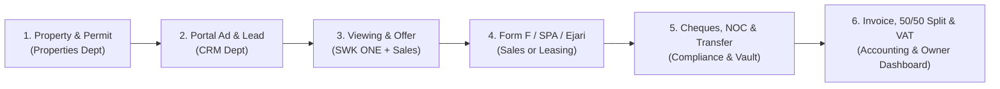

### 1.2 What You Control Directly vs. What Requires Owner (Shabib Siraj) Approval
SWK Properties OS is built around a clear governance chain between **Shabib Siraj (Owner)**, **Mohammad Haseeb (Operations Manager)**, **Talha Shabbir (BDM & IT Admin)**, and the **Sales Advisors**:

| Operational Area | Mohammad Haseeb’s Direct Authority (Operations Manager) | When Owner (Shabib Siraj) Approval Is Required |
|---|---|---|
| **1. All Leads, Calls & Deals Across the Company** | Unlike Sales Advisors (who only see their own assigned clients), you can **view, create, edit, assign, and reassign every lead, call, viewing, and deal** across all 3 departments. | If a lead or deal record needs to be **deleted**, your delete request requires a specific reason and goes to the **Delete Bin** for **Owner Shabib Siraj** approval. |
| **2. Administrative Decisions (`manager_admin_decisions`)** | You prepare and recommend administrative decisions (policy exceptions, commission split adjustments, fee waivers, HR/disciplinary actions, or special commercial terms). | **Every administrative decision must be approved by Owner Shabib Siraj** before taking effect. Submit it with full justification so the Owner receives an instant alert. |
| **3. Deal Withdrawals & Client Refunds (`Withdrawals`)** | You inspect the client/developer withdrawal request, verify the contract terms and payment mode, calculate any forfeiture/retention, and perform the **Manager Review**. | You **cannot** release a refund alone. After your review, the request moves to `Pending Owner Approval`—only **Owner Shabib Siraj** can approve the final client refund. |
| **4. Record Edits & Deletions (`Audit Trail` & `Delete Bin`)** | You can edit operational records across CRM, Properties, Sales, Leasing, HR, and Finance—every edit requires a **specific reason** which is logged in the Audit Trail and sent to Owner, Manager, and IT. | Whenever you or any staff member deletes a record, it is held in the **Delete Bin (`Pending Owner Approval`)** until **Owner Shabib Siraj** permanently approves or restores it. |
| **5. Daily Attendance, Late Contemptors & Checkout Gate** | You monitor the `10:00 AM` arrival roll call (`10:05 AM` grace), receive **Continuous Contemptor Alerts** (≥3 late arrivals in 7 days) alongside the Owner, take written reports from late staff, verify GPS site visits, and enforce the `7:00 PM` **Daily Report Checkout Gate**. | Waiving a repeated contemptor warning or changing a staff member’s employment status/contract requires **Owner Shabib Siraj** approval. |
| **6. Legal UAE Payments & 50/50 Commission Splits** | You verify that client payments arrive strictly via **SWK corporate bank accounts, DLD Escrow, Manager’s Cheque, Licensed Exchange, or VARA-compliant USDT/Crypto** (never a broker’s personal account) and verify the **50% SWK / 50% Advisor** net split (after any 3rd-party A2A deduction). | Final payout disbursement and high-value financial sign-offs follow the Owner signing rules. |

---

## Part 2 — How to Navigate Any Screen in 10 Seconds (The 4 Simple Rules)

Every screen in **SWK Properties OS** follows the same four rules so you can supervise the entire brokerage effortlessly:

### Rule 1: Sign In at the Private Gate
Open `https://os.swkpropertiesuae.com` in your browser (or open the **SWK ONE** app on your Android phone). Sign in with your Operations Manager credentials (`manager@swkpropertiesuae.com`).

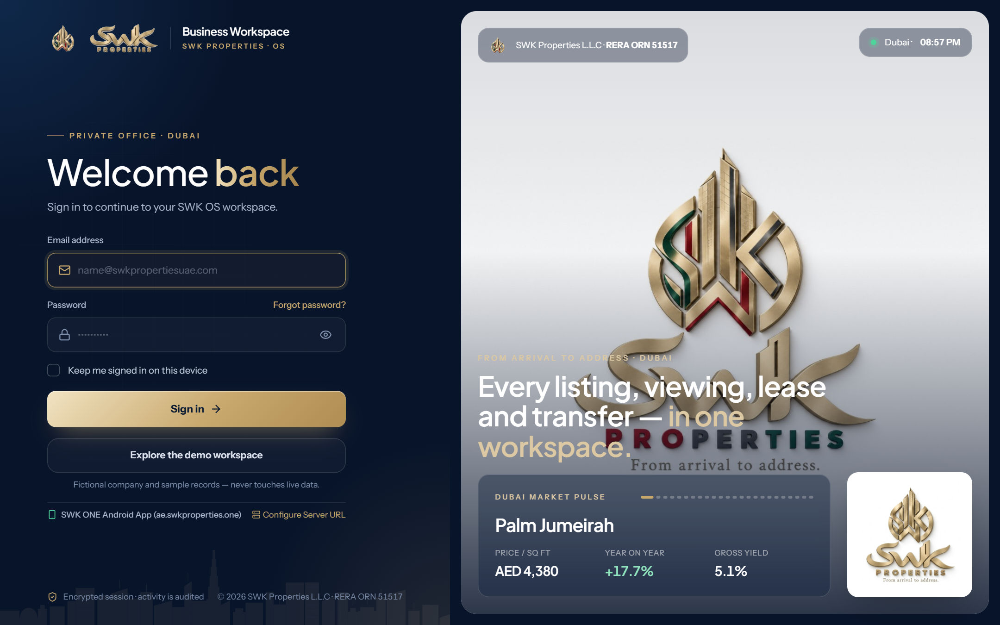

- **First Sign-In Security**: If signing in with a temporary password, the system will prompt you to set your personal password before unlocking business data.
- **Right Panel**: Displays live Dubai time (`GST, UTC+4`), `RERA ORN 51517`, and the live **Dubai Market Pulse** ticker.

---

### Rule 2: Start at the 12-Department Home Screen (“All Apps”)
Right after signing in, you arrive at the **All Apps Home Screen** (`/home`).

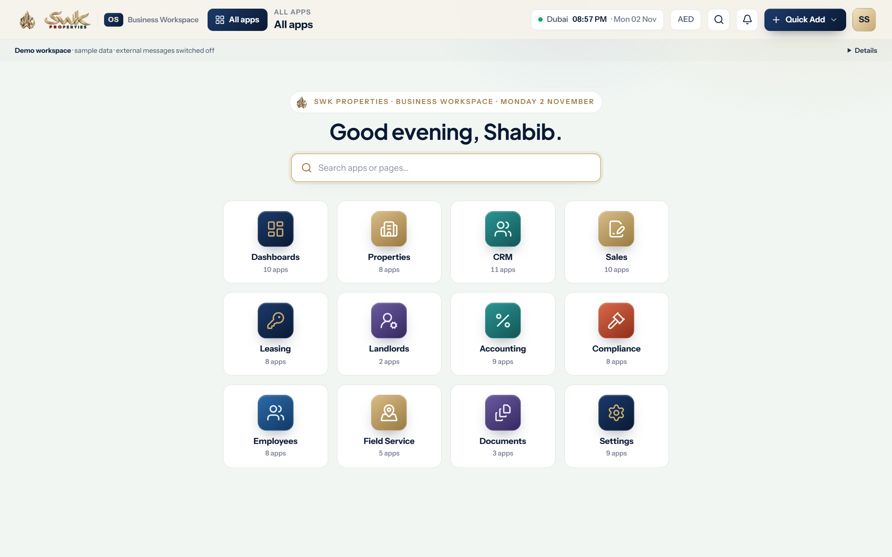

- **12 Department Tiles**: Every operation in SWK Properties sits inside one of these 12 tiles (**Dashboards**, **Properties**, **CRM**, **Sales & mandates**, **Leasing & management**, **Landlords**, **Accounting**, **Compliance**, **Employees**, **Field Service**, **Documents**, **Settings**).
- **Instant Search Bar**: Type any keyword (`"noc"`, `"cheque"`, `"attendance"`, `"withdrawal"`, `"Marina"`) and press **Enter** to jump straight to that screen.
- **Recent Strip**: One-click pills for the screens you visited most recently.

---

### Rule 3: Follow the Numbered Steps (`1, 2, 3...`) on the Left App-Icon Sidebar
When you open any department, the left side of the screen displays a **2-column App-Icon Sidebar** where every icon is numbered **`1`, `2`, `3`, `4`...** in exact UAE real estate workflow order.

````carousel
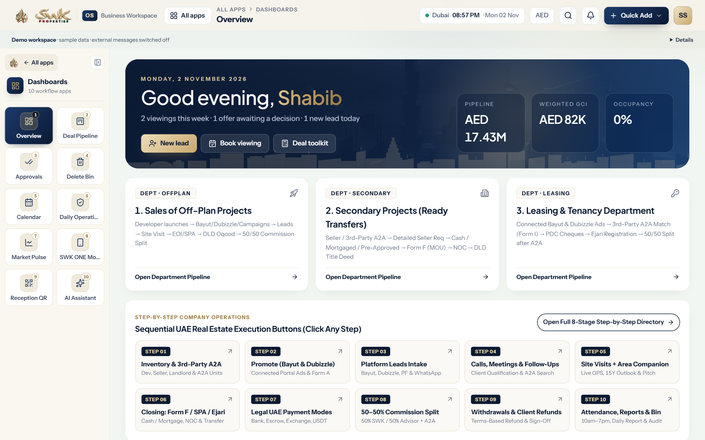
<!-- slide -->
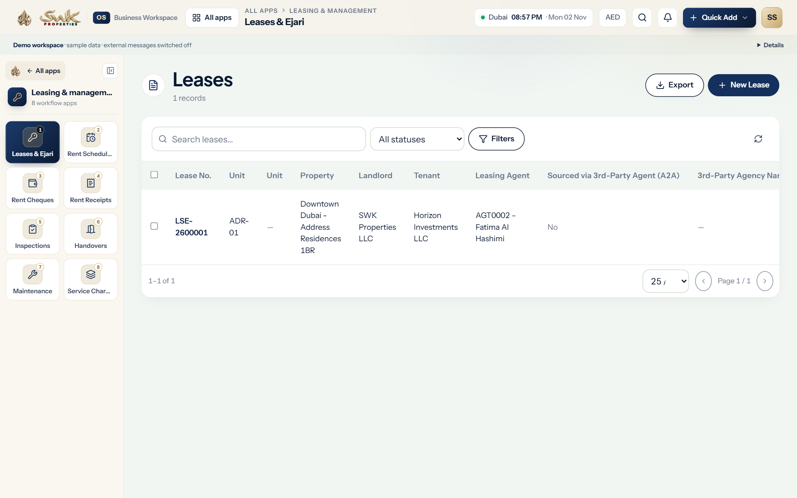
````

- **How to Guide Your Brokers**: Train every Sales Advisor to move sequentially from **Step `1` → Step `2` → Step `3`** in their department. If a step is skipped (for example, trying to advertise a unit in Step `5` before uploading the Owner Permit in Step `2`, or trying to close a non-converted lead without entering a specific non-conversion reason), the system blocks the mistake automatically.
- **Returning Home**: Click **All apps** at the top of the left sidebar (or the SWK logo in the top bar) at any time.

---

### Rule 4: Use the Top Bar From Anywhere
| Top Bar Control | How Mohammad Haseeb Uses It Daily |
|---|---|
| **SWK Logo / `All apps`** | Returns immediately to the 12-Department Home Screen. |
| **Breadcrumb & Page Title** | Confirms which department and step you are inspecting. |
| **Dubai Clock & AED Badge** | Live Gulf Standard Time (`GST`) — use to verify `10:00 AM` check-in (`10:05 AM` grace), `10:30 AM` attendance report, and `7:00 PM` (`4:00 PM` Saturday) sign-out. |
| **Global Search (`Ctrl + K`)** | Look up any client phone number, unit number, Form F, Ejari, cheque number, or broker name in 1 second when a client or agent calls you. |
| **Bell Icon (`Notifications`)** | Alerts you immediately when a broker submits a new property, requests an approval, logs a withdrawal, triggers a **Continuous Contemptor** late alert, or edits/deletes a record. |
| **`+ Quick Add` Button** | Create a **New Lead**, **Submit Property**, **Book Viewing**, **New Sale File**, **New Lease (Ejari)**, **Request NOC**, or **Daily Report** from any page in two clicks. |

---

## Part 3 — Mohammad Haseeb’s Daily Management Schedule (`10:00 AM – 7:00 PM`)

Here is your exact daily operational routine inside **SWK Properties OS** (Monday–Friday `10:00 AM – 7:00 PM`, Saturday `10:00 AM – 4:00 PM`, Sunday Holiday with client-based variable hours logged):

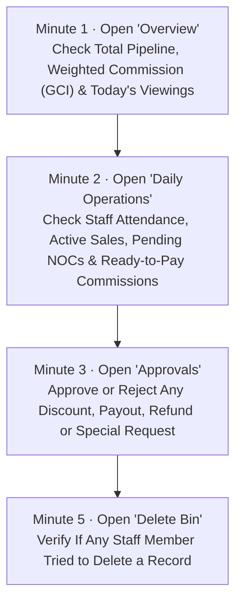

1. **10:00 AM – 10:05 AM — Office Opening & Reception QR Roll Call (`Field Service → Step 2: Reception QR`)**:
   - Ensure the rotating **Reception QR** terminal is live at the entrance.
   - Staff scanning in up to **10:05 AM** are recorded as **On-Time**.
   - Any broker who is outside the office for a scheduled morning viewing checks in via **Live GPS** on the **SWK ONE** app (`Field Service → Step 4: Field Visits`), which automatically registers their attendance against their viewing schedule.
2. **10:30 AM — Attendance Report & Continuous Contemptor Action (`Employees → Step 5: Attendance`)**:
   - At **10:30 AM**, Owner **Shabib Siraj** receives the automated WhatsApp Attendance Report, and any staff member with **≥3 late arrivals (`>10:05 AM`) in 7 days** triggers a **Continuous Contemptor Alert** to both the Owner and you.
   - Call in any late or contemptor staff member immediately, take their written explanation, log your coaching note, and guide them on schedule compliance.
3. **10:45 AM – 1:00 PM — Lead Routing & Portal Syndication Check (`CRM → Step 1: Leads` & `Properties → Step 1 & Step 5`)**:
   - Check new enquiries from **Bayut**, **Dubizzle**, Property Finder, and digital campaigns (coordinated with **Talha Shabbir**, BDM & IT Admin).
   - If any broker has not called a new lead within the SLA window, reassign the lead in `CRM → Step 1: Leads`.
   - Review new seller/landlord/A2A property submissions in `Properties → Step 1: New Submissions` and verify RERA Form A / Trakheesi permits before publishing in `Step 5: Listing Studio`.
4. **2:00 PM – 5:30 PM — Active Deal Supervision Across All 3 Departments (`Dashboards → Step 6: Daily Operations` & `Sales / Leasing`)**:
   - Inspect active **Off-Plan** bookings (EOI, SPA, Oqood), **Secondary** sales (Buyer finance status, Form F, 10% deposit in Escrow, Developer NOC, DLD Trustee transfer), and **Leasing** contracts (Ejari, PDC Cheque Vault maturities).
   - If a client or developer withdraws from a deal, review the calculation in `Sales → Step 10: Withdrawals` and forward your recommendation to **Owner Shabib Siraj**.
   - If an administrative decision is needed, log it for **Owner Shabib Siraj** approval before execution.
5. **6:30 PM – 7:00 PM (3:30 PM – 4:00 PM on Saturdays) — Mandatory Daily Report & Checkout Gate (`Field Service → Step 5: Daily Reports`)**:
   - Remember: the **Checkout Gate** blocks any broker from checking out until:
     1. All of their scheduled site visits (`viewings`) for today have arrival GPS and client feedback recorded, **AND**
     2. Their **Daily Report** has been submitted.
   - Review the submitted Daily Reports in `Dashboards → Step 6: Daily Operations` (`Daily Work Reports` tab) before signing out at `7:00 PM`.

---

## Part 4 — Complete Department-by-Department Manager Guide (All 12 Departments)

Below is how you use each of the **12 Departments** as Operations Manager to supervise staff, enforce UAE real estate rules, and keep data 100% accurate.

---

### Department 1: Dashboards (Your Operations Command Centre)

**Manager’s Role**: Monitor live pipeline across the 3 departments (`OFFPLAN`, `SECONDARY`, `LEASING`), process operational approvals, check the Delete Bin queue, and give brokers live market data.

````carousel

<!-- slide -->
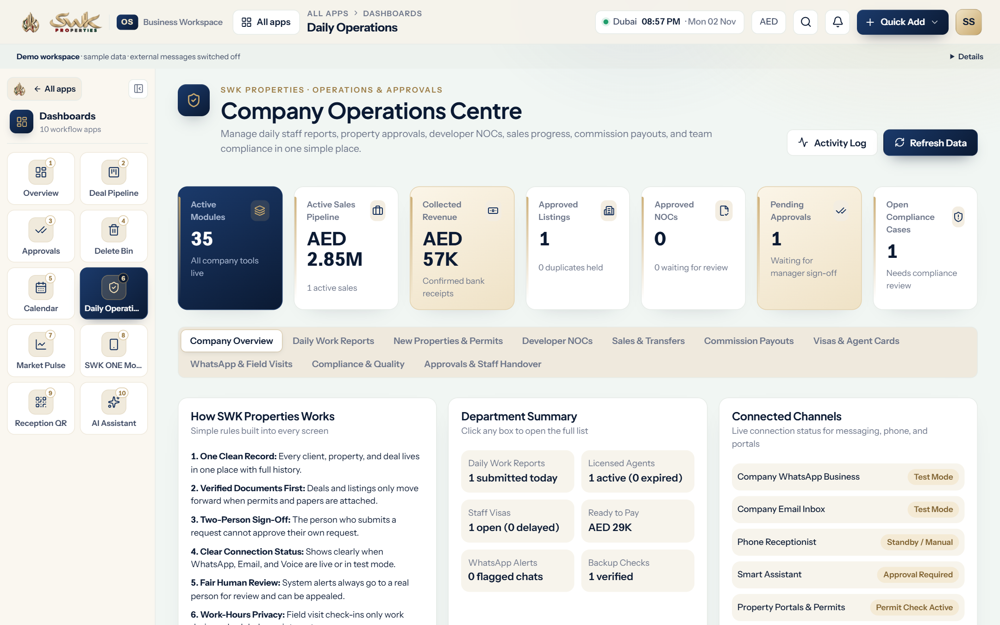
<!-- slide -->
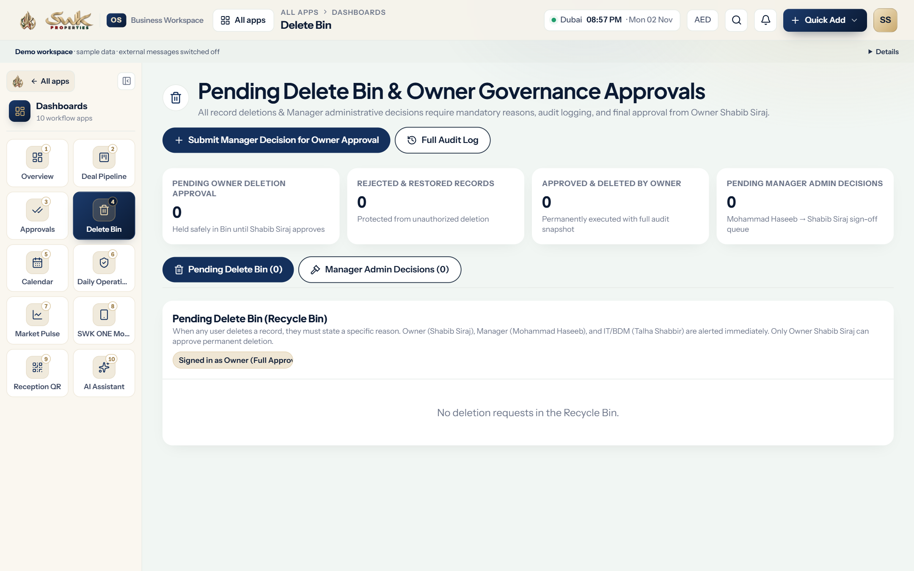
<!-- slide -->
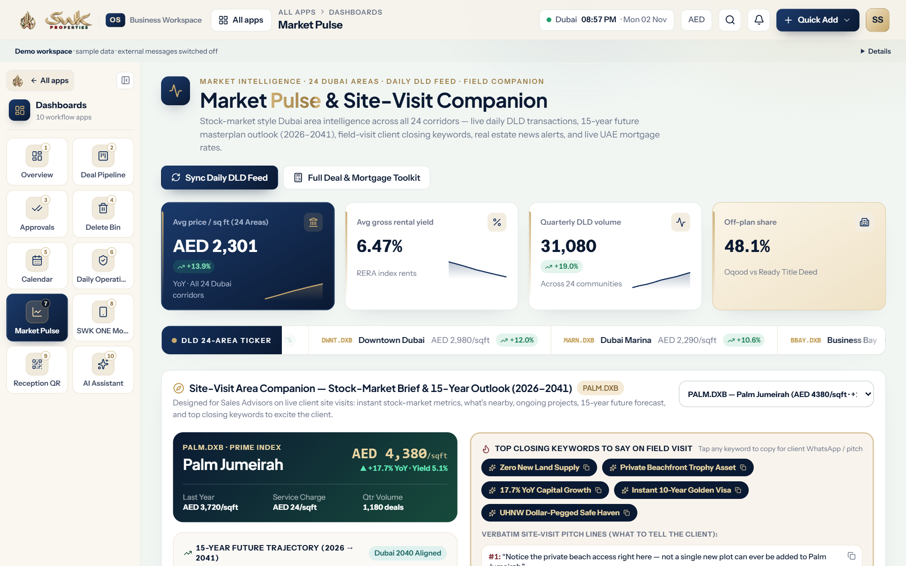
````

| Step | App Icon | What Mohammad Haseeb Checks & Does Here |
|---|---|---|
| **1** | **Overview** | Check the 3 Department Command Cards (*Sales of Off-Plan Projects*, *Secondary Projects*, *Leasing*) and the **10-Step Sequential UAE Execution Buttons**. Spot bottlenecks in leads, viewings, or pending closings. |
| **2** | **Deal Pipeline** | Drag-and-drop / inspect deals across stages. Filter by **Off-Plan**, **Secondary**, or **Leasing** to see which broker is closest to closing this week. |
| **3** | **Approvals** | Review operational requests from staff. Approve items within your operational scope, and escalate administrative decisions to **Owner Shabib Siraj**. |
| **4** | **Delete Bin** | Inspect any record a staff member requested to delete along with their mandatory reason. **Note**: Only **Owner Shabib Siraj** can execute permanent deletion from the Delete Bin; use this screen to verify why a broker requested a deletion. |
| **5** | **Calendar** | Master schedule of all broker site visits, client meetings, Developer NOC appointments, DLD transfers, and lease renewals. |
| **6** | **Daily Operations** | **Your #1 Management Screen.** Switch across its 9 tabs (*Daily Work Reports*, *New Properties & Permits*, *Developer NOCs*, *Sales & Transfers*, *Commission Payouts*, *Visas & Agent Cards*, *WhatsApp & Field Visits*, *Compliance & Quality*, *Approvals & Staff Handover*) to run the entire floor from one page. |
| **7** | **Market Pulse** | Live benchmarks for **24 Dubai communities** (price/sq ft, YoY growth, rental yield, daily DLD transactions, real estate news, and UAE mortgage calculator). Train brokers to open the **Site-Visit Area Companion** here before every viewing. |
| **8** | **SWK ONE Mobile** | Preview the mobile app interface and check live broker duty status, checkout gate status, and field sessions. |
| **9** | **Reception QR** | Open on the office reception tablet so the rotating 15-second QR code is ready for `10:00 AM` check-in and `7:00 PM` check-out. |
| **10** | **AI Assistant** | Ask the AI team (Jarvis) for instant operational summaries, overdue follow-ups, or draft client communications. |

---

### Department 2: Properties (8-Step Inventory Verification, Permits & Portal Ads)

**Manager’s Role**: Ensure every Off-Plan, Secondary, and Leasing unit has verified seller/landlord requirements (or 3rd-party A2A agent details recorded) and a valid RERA permit before it is promoted on Bayut or Dubizzle.

````carousel
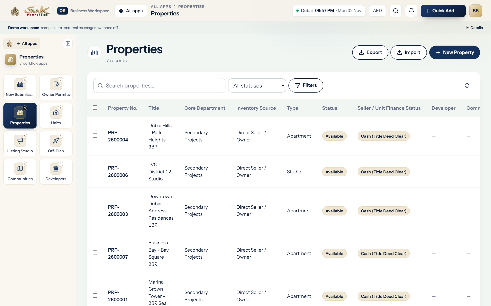
<!-- slide -->
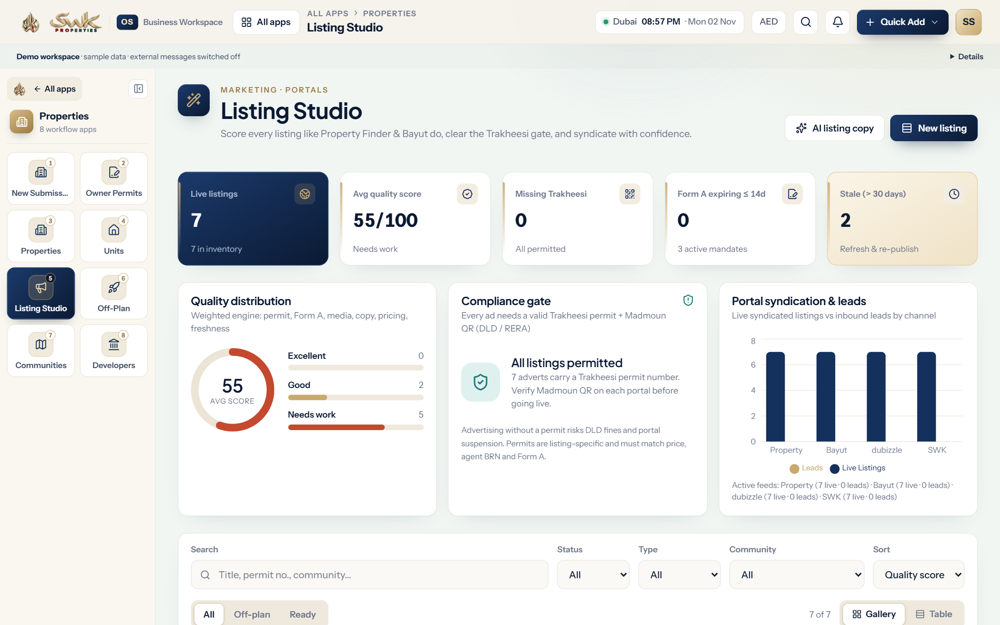
````

| Step | App Icon | What Mohammad Haseeb Checks & Does Here |
|---|---|---|
| **1** | **New Submissions** | **Manager Approval Gate.** When a broker sources a Secondary or Leasing unit from a direct seller/landlord or a **3rd-Party Agent (A2A)**, they submit it here with detailed seller requirements (minimum price, mortgage status, occupancy, A2A split). Review the title deed/passport and click **Approve** to promote it into the inventory. |
| **2** | **Owner Permits** | Verify that signed **RERA Form A** and **Trakheesi permit numbers** are recorded and active. Never allow a unit without a permit to be advertised. |
| **3** | **Properties** | Master list of buildings and villa projects. Keep developer and service-charge links accurate. |
| **4** | **Units** | Inspect available, reserved, sold, and leased units. Check whether a unit is **Direct Mandate** or **3rd-Party A2A Partner Inventory** (when SWK does not hold direct inventory matching a client’s requirement, record the 3rd-party A2A broker here). |
| **5** | **Listing Studio** | Coordinate with **Talha Shabbir (BDM & IT Admin)** to publish verified units to **Bayut**, **Dubizzle**, and Property Finder and track portal feed health. |
| **6** | **Off-Plan** | Manage developer project inventory, launch payment plans, EOI deadlines, and developer commission rates for the **Off-Plan Department**. |
| **7** | **Communities** | Maintain community profiles across all 24+ Dubai districts. |
| **8** | **Developers** | Master developer contacts (Emaar, DAMAC, Sobha, Nakheel, Meraas, Binghatti) and NOC rules. |

---

### Department 3: CRM (11-Step Company-Wide Lead Routing, Calls, WhatsApp & Follow-Ups)

**Manager’s Role**: While each Sales Advisor is restricted to viewing only their own assigned leads, **you see all leads across the entire company**. Your job is to make sure every Bayut, Dubizzle, website, WhatsApp, and campaign lead is contacted fast, followed up properly, and either converted or closed with a **mandatory specific non-conversion reason**.

````carousel
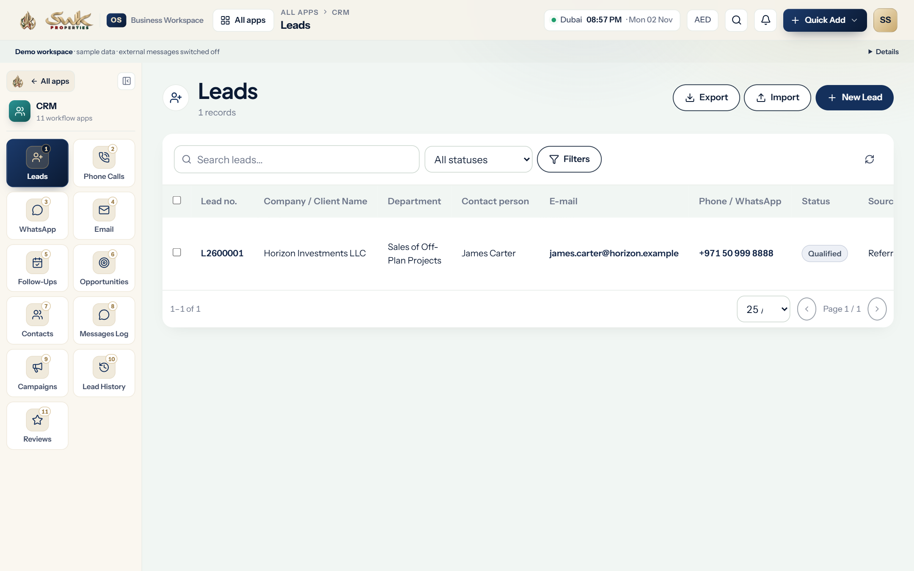
<!-- slide -->
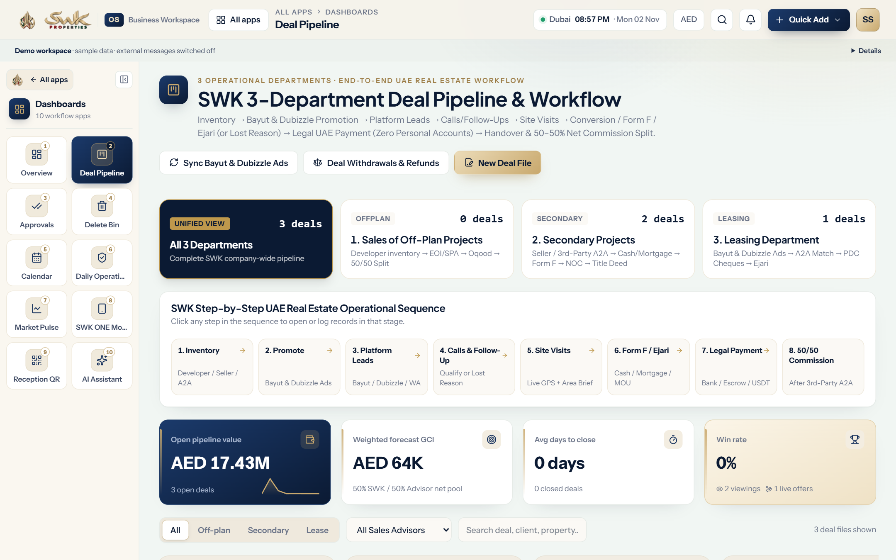
````

| Step | App Icon | What Mohammad Haseeb Checks & Does Here |
|---|---|---|
| **1** | **Leads** | Monitor incoming leads across all 3 departments (`Sales of Off-Plan Projects`, `Secondary Projects`, `Leasing`). **Enforcement Rule**: If a broker marks a lead as *Disqualified / Lost / Not Converted*, the system requires a **specific non-conversion reason**—review those reasons daily to see if another unit or broker can save the deal. |
| **2** | **Phone Calls** | Audit broker call logs and notes to ensure advisors are making their daily call targets and qualifying buyer finance status (*Cash*, *Mortgaged*, *Pre-Approved*). |
| **3** | **WhatsApp** | Supervise company WhatsApp threads so client conversations stay on the official company channel rather than disappearing on personal phones. |
| **4** | **Email** | Review formal offer letters and client correspondence. |
| **5** | **Follow-Ups** | Check overdue tasks and callbacks across all brokers; nudge or reassign if a hot client is waiting. |
| **6** | **Opportunities** | Review qualified buyer/tenant requirements. If SWK lacks direct inventory for an opportunity, instruct the advisor to match a **3rd-Party A2A Agent** unit (RERA Form I). |
| **7** | **Contacts** | Master directory of Buyers, Sellers, Landlords, Tenants, and **3rd-Party A2A Brokers**. |
| **8** | **Messages Log** | Full audit trail of outbound/inbound client messages. |
| **9** | **Campaigns** | Work with **Talha Shabbir (BDM & IT Admin)** to track lead volume and conversion rate from Bayut, Dubizzle, Instagram, and Google campaigns. |
| **10** | **Lead History** | Inspect when a lead was assigned or reassigned to settle any broker ownership dispute fairly. |
| **11** | **Reviews** | Check post-viewing and post-closing client feedback on broker professionalism. |

---

### Department 4: Sales & Mandates (10-Step Off-Plan & Secondary Sales, Form F, NOC, DLD & Withdrawals)

**Manager’s Role**: Guide every Off-Plan and Secondary deal from viewing and offer to Form F / SPA, legal payment collection, NOC, DLD Trustee transfer, and handover—and perform the mandatory Manager Review on any deal withdrawal or refund request.

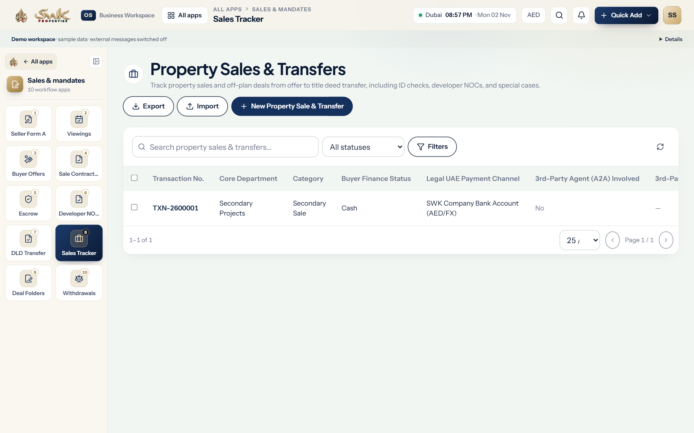

| Step | App Icon | What Mohammad Haseeb Checks & Does Here |
|---|---|---|
| **1** | **Seller Form A** | Verify signed Seller Form A agreements, seller requirements (cash vs. mortgaged property, payoff bank if mortgaged), and commission % before marketing. |
| **2** | **Viewings** | Check scheduled viewings and ensure brokers check in via **Live GPS** on **SWK ONE** and log client feedback afterward (required to unlock their evening checkout). |
| **3** | **Buyer Offers** | Verify buyer finance status (**Cash Buyer**, **Mortgage Pre-Approved**, or **Mortgage In Progress**) and ensure payment mode is 100% legal under UAE regulations. |
| **4** | **Sale Contract (F)** | Supervise **RERA Form F (MOU)** signing for Secondary units (or **SPA / Oqood** for Off-Plan units) and verify that 3rd-Party A2A details (Form I) are recorded if co-brokered. |
| **5** | **Escrow** | Track the 10% security deposit cheque or developer escrow payment. |
| **6** | **Developer NOC** | Track Developer NOC applications, service charge settlements, and mortgage clearance letters so transfers are never delayed. |
| **7** | **DLD Transfer** | Confirm completion at the **DLD Registration Trustee** office, Title Deed / Oqood issuance, and Manager’s Cheque handover. |
| **8** | **Sales Tracker** | Master progress board of all active Off-Plan and Secondary sales. |
| **9** | **Deal Folders** | Final audit of the complete deal file before commission invoicing. |
| **10** | **Withdrawals** | **Deal Cancellations & Client Refunds (`deal_withdrawals`).** When a developer, seller, or buyer withdraws, verify the stage of withdrawal, the payment mode/amount received, and the contract terms agreed at the time of payment. Click **Manager Review & Forward to Owner**—final refund approval is reserved for **Owner Shabib Siraj**. |

---

### Department 5: Leasing & Management (8-Step Ejari, PDC Cheque Vault, Inspections & Repairs)

**Manager’s Role**: Supervise residential and commercial leasing, Bayut/Dubizzle portal promotion, A2A partner leasing deals, Ejari registration, Post-Dated Cheque (PDC) maturity deposits, and key handovers.

````carousel

<!-- slide -->
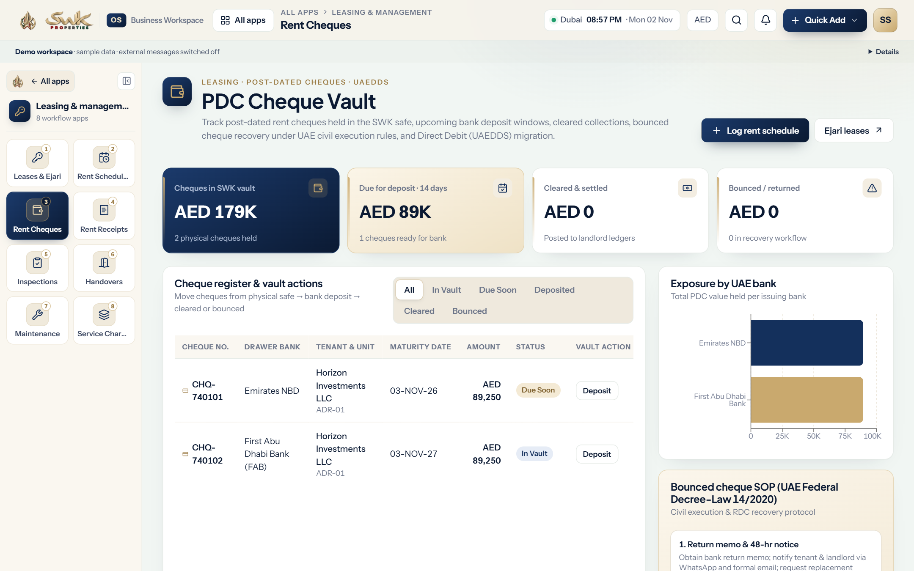
````

| Step | App Icon | What Mohammad Haseeb Checks & Does Here |
|---|---|---|
| **1** | **Leases & Ejari** | Verify tenancy contracts, Ejari certificate numbers, security deposits, cheque counts, and 90-day RERA renewal notices. If sourced via a 3rd-party A2A agent, confirm the A2A broker is linked. |
| **2** | **Rent Schedules** | Monitor upcoming and overdue rent instalments across managed units. |
| **3** | **Rent Cheques** | **PDC Cheque Vault.** Review cheques maturing in the next 14 days, ensure timely bank deposit, and follow the UAE Federal Decree-Law 14/2020 protocol if any cheque bounces. |
| **4** | **Rent Receipts** | Ensure official SWK receipts are issued only for payments received into official company/landlord accounts. |
| **5** | **Inspections** | Verify Move-In and Move-Out inspection reports before approving security deposit returns. |
| **6** | **Handovers** | Confirm key, access card, and DEWA clearance logs at tenant move-in/move-out. |
| **7** | **Maintenance** | Approve repair work orders within your operational limit and ensure landlord/tenant cost allocation is accurate. |
| **8** | **Service Charges** | Track RERA Mollak service charges for managed properties. |

---

### Department 6: Landlords (Owner Portfolios & Payout Statements)

**Manager’s Role**: Maintain relationships with property owners and review net payout statements before disbursement.

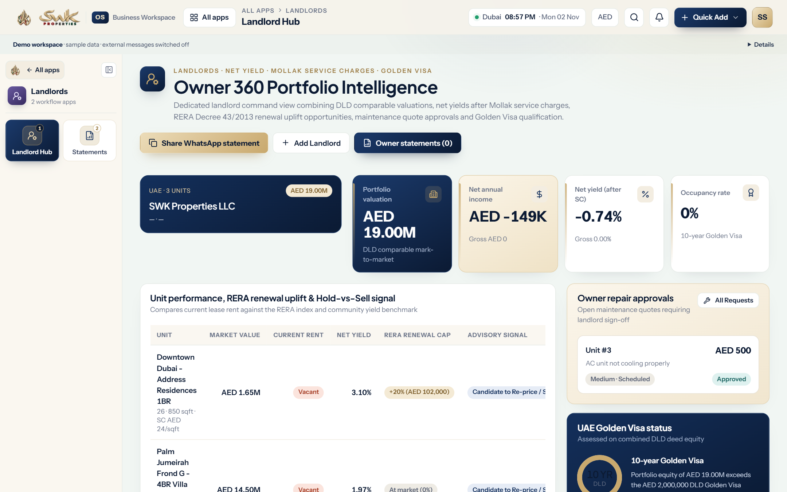

| Step | App Icon | What Mohammad Haseeb Checks & Does Here |
|---|---|---|
| **1** | **Landlord Hub** | Review unit occupancy, gross rent, and net yield across each landlord’s portfolio. |
| **2** | **Statements** | Verify `Collected Rent − SWK Management Fee − Approved Maintenance = Net Payout` before forwarding statements for payout sign-off. |

---

### Department 7: Accounting (9-Step Legal UAE Payments, 50/50 + A2A Commissions & VAT)

**Manager’s Role**: Enforce **strictly legal UAE payment modes** (zero tolerance for Sales Advisor personal accounts) and verify the **50% SWK / 50% Sales Advisor commission split** (after deducting any 3rd-party A2A partner share).

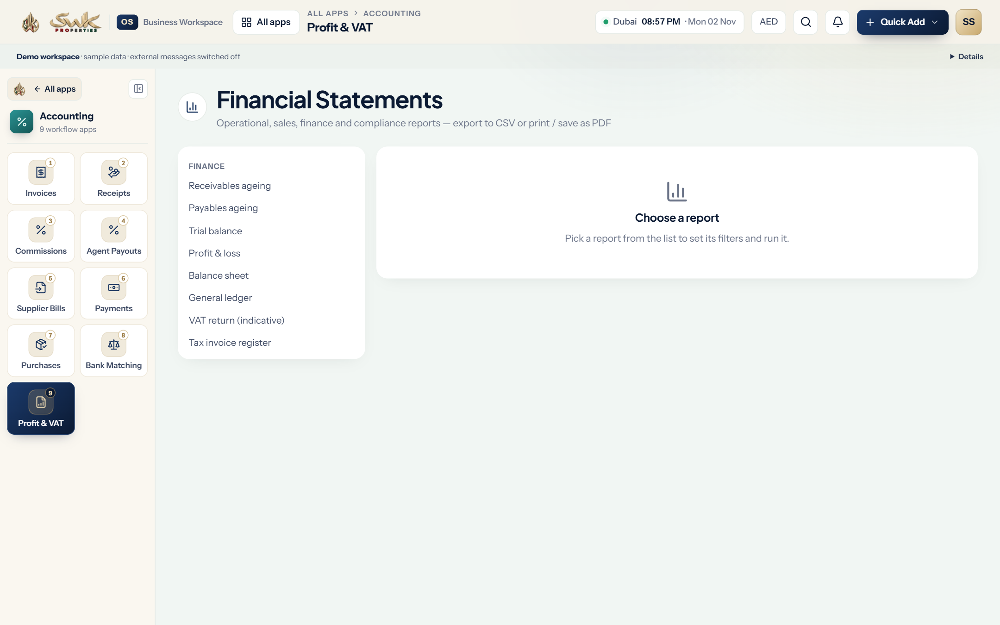

> [!WARNING]
> **Strict UAE Payment Compliance Rule**: No client payment (deposit, booking, rent, or commission) may ever be received in a Sales Advisor’s personal bank account. SWK Properties OS automatically blocks any receipt or transaction referencing a personal account (`400 Bad Request`). Permitted legal modes are: **SWK Corporate Bank Account (AED/FX)**, **Developer DLD Escrow Account**, **Manager’s Cheque**, **Post-Dated Cheques (PDC)**, **Worldwide Currency Exchange (Licensed UAE Exchange House)**, and **UAE-Permitted Crypto / USDT (VARA-Licensed Gateway)**.

| Step | App Icon | What Mohammad Haseeb Checks & Does Here |
|---|---|---|
| **1** | **Invoices** | Ensure FTA-compliant 5% VAT Tax Invoices are generated for every closed Off-Plan, Secondary, and Leasing deal. |
| **2** | **Receipts** | Verify that incoming funds cleared via an approved legal UAE payment channel into the SWK corporate account. |
| **3** | **Commissions** | Verify the automatic commission formula:<br>1. **Gross Commission (excl. VAT) − 3rd-Party A2A Share = Net Company Pool**.<br>2. **50% to SWK Properties** and **50% to the Sales Advisor**. |
| **4** | **Agent Payouts** | Confirm that the client’s invoice is marked *Paid* and all Deal Folder documents are uploaded before recommending broker payout release to **Owner Shabib Siraj**. |
| **5–9** | **Bills, Payments, Purchases, Bank Matching, Profit & VAT** | Coordinate with Finance on supplier bills, portal invoices, bank reconciliation, and quarterly 5% VAT reporting. |

---

### Department 8: Compliance (RERA, Trakheesi, KYC & Anti-Money Laundering)

**Manager’s Role**: Ensure 100% RERA, DLD, KYC, and goAML compliance across all transactions.

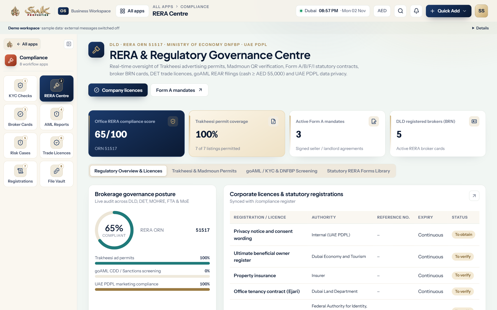

| Step | App Icon | What Mohammad Haseeb Checks & Does Here |
|---|---|---|
| **1** | **KYC Checks** | Ensure every buyer, seller, landlord, and corporate client has verified Passport, Emirates ID, and sanctions screening before signing Form F or accepting USDT/Crypto/high-value funds. |
| **2** | **RERA Centre** | Audit **Form A**, **Form B**, **Form I (A2A)**, **Form F**, and **Trakheesi** permits across the team. |
| **3** | **Broker Cards** | Monitor **RERA BRN card** expiry dates for all Sales Advisors so no broker operates with an expired card. |
| **4–8** | **AML Reports, Risk Cases, Trade Licences, Registrations, File Vault** | Review goAML reports for cash/crypto deals, resolve compliance exceptions, and ensure all signed contracts are stored in the File Vault. |

---

### Department 9: Employees (Sales Advisors, Company Visas, Attendance & Leaderboard)

**Manager’s Role**: Supervise all **Sales Advisors** (sponsored on **SWK Properties Company Visa** with **AED 0 Basic Salary** and **50–50% Commission Split**), monitor daily attendance (`10:00 AM – 7:00 PM` Mon–Fri, `10:00 AM – 4:00 PM` Sat, Sunday Holiday), and coach the team using the Leaderboard.

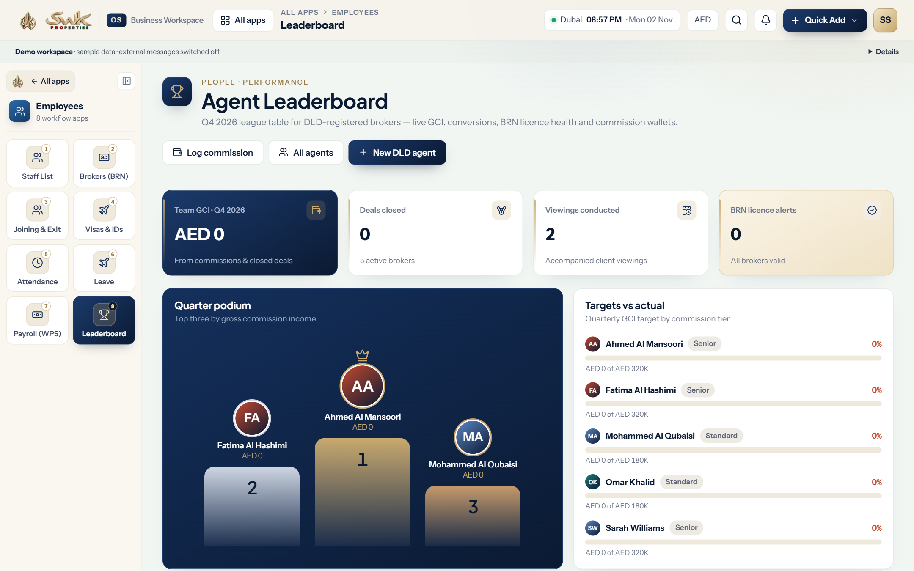

| Step | App Icon | What Mohammad Haseeb Checks & Does Here |
|---|---|---|
| **1** | **Staff List** | View employee records. Confirm that all Sales Advisors are configured under `Commission Only (50/50 Company Visa – 0 Basic)` (`basic_salary = 0`, `company_visa_sponsored = true`, `50/50 split`). |
| **2** | **Brokers (BRN)** | Assign each Sales Advisor to their core department (**Sales of Off-Plan Projects**, **Secondary Projects**, or **Leasing**) and target Dubai communities. |
| **3** | **Joining & Exit** | Run the onboarding checklist for new brokers and ensure full lead/device handover before any departing broker’s clearance. |
| **4** | **Visas & IDs** | Track Company Visa, Labour Card, Emirates ID, and Medical Insurance expiry dates. |
| **5** | **Attendance** | Inspect daily check-ins (`≤10:05 AM` On-Time vs. `>10:05 AM` Late), client-based variable hours reasons, and **Continuous Contemptor** flags. |
| **6** | **Leave** | Review leave requests and ensure active leads/viewings are covered before recommending approval. |
| **7** | **Payroll (WPS)** | Review monthly payroll batches (AED 0 basic for Commission-Only Sales Advisors + approved commission entitlements; salaried payroll for management/operations). |
| **8** | **Leaderboard** | Drive weekly sales performance meetings using live GCI, deal count, and viewing conversion rankings. |

---

### Department 10: Field Service (SWK ONE Mobile App, Reception QR, GPS Visits & Checkout Gate)

**Manager’s Role**: Enforce real-time field accountability using the **SWK ONE** Android app (`ae.swkproperties.one`).

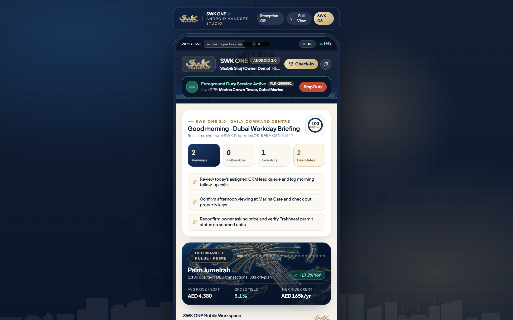

| Step | App Icon | What Mohammad Haseeb Checks & Does Here |
|---|---|---|
| **1** | **SWK ONE App** | Use on your own phone and verify how brokers check in, view scheduled site visits, use the **Site-Visit Area Companion** (15-year area outlook + closing pitch keywords), and submit daily reports. |
| **2** | **Reception QR** | Keep displayed on the office reception screen (`10:00 AM` arrival / `7:00 PM` sign-out). |
| **3** | **Gate Logs** | Audit raw QR scan and GPS arrival timestamps. |
| **4** | **Field Visits** | When a broker is outside the office for a morning or afternoon viewing, verify that they checked in via **Live GPS** at the property location (`Field Site Visit Live GPS`) matching their scheduled viewing. |
| **5** | **Daily Reports** | Read every broker’s end-of-day report. Remember: the **Checkout Gate** prevents a broker from signing out until their scheduled viewings and today’s **Daily Report** are submitted. |

---

### Department 11: Documents (Instant Deal Calculators, Letter Studio & Reports)

**Manager’s Role**: Equip brokers with accurate financial calculations during client negotiations and export operational reports.

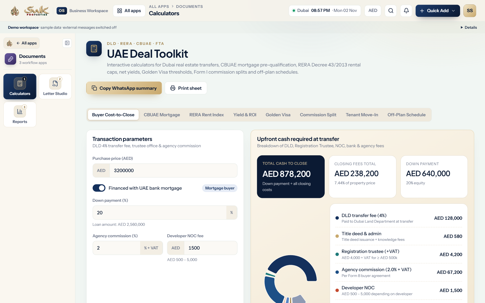

| Step | App Icon | What Mohammad Haseeb Checks & Does Here |
|---|---|---|
| **1** | **Calculators** | Use the **DLD 4% Transfer Fee Calculator**, **UAE Mortgage Calculator** (Expat 80% LTV / UAE National 85% LTV / live UAE bank rates), **Net Rental Yield Calculator**, and **50/50 + A2A Commission Split Calculator** to verify numbers during deal closing. |
| **2** | **Letter Studio** | Generate official SWK Properties offer letters, reservation forms, NOC requests, and landlord notices. |
| **3** | **Reports** | Export weekly and monthly department performance reports for **Owner Shabib Siraj**. |

---

### Department 12: Settings (Company Directory, Branches & Audit Visibility)

**Manager’s Role**: View branch geofences, company details, and audit history while respecting Owner-only security boundaries.

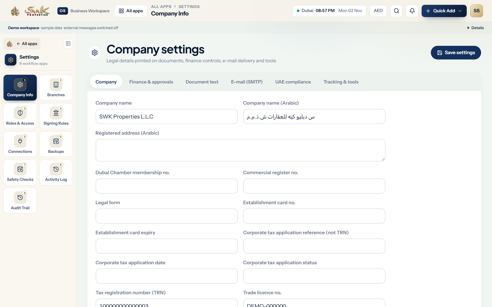

- You have **view access** to Company Info, Branches, Roles, and Integrations (managed technically alongside **Talha Shabbir, BDM & IT Admin**).
- Any change to corporate governance thresholds, role permissions, or permanent deletion approvals is reserved exclusively for **Owner Shabib Siraj**.

---

## Part 5 — Five Core Manager Playbooks (Step-by-Step Operational Execution)

### Playbook 1: Running the `10:00 AM` Roll Call, `10:30 AM` Report & Coaching Continuous Contemptors
1. **10:00 AM – 10:05 AM**: In-office brokers scan the **Reception QR** (`Field Service → Step 2`). Brokers at an early client site visit check in via **Live GPS** on **SWK ONE** (`Field Service → Step 4`), which automatically registers their attendance against their scheduled viewing.
2. **10:06 AM Onwards**: Any check-in after `10:05 AM` (without an approved client-schedule variable hours reason) is marked **Late** with exact late minutes.
3. **10:30 AM Alert**: Owner **Shabib Siraj** receives the automated WhatsApp Attendance Report. If any broker reaches **≥3 late arrivals in 7 rolling days**, the system fires a **Continuous Contemptor Alert** to both **Owner Shabib Siraj** and **Mohammad Haseeb** and creates an urgent coaching task.
4. **Manager Action**: Open `Employees → Step 5: Attendance`, meet the broker, record their explanation and your guidance note, and update the task for the Owner’s visibility.

---

### Playbook 2: Supervising a Secondary Sale (Seller Requirement → A2A → Form F → Legal Payment → 50/50 Split)
1. **Seller / A2A Intake (`Properties → Step 1: New Submissions`)**: Verify whether the property comes directly from a Seller or via a **3rd-Party Agent (A2A)**. Ensure the seller’s detailed requirements (minimum net price, cash vs. mortgaged property, notice period) and signed **Form A / Trakheesi permit** (`Step 2`) are uploaded before approving the listing.
2. **Portal Promotion & Lead Qualification (`Properties → Step 5: Listing Studio` → `CRM → Step 1: Leads`)**: Promote on Bayut & Dubizzle. Ensure the broker qualifies the buyer’s finance status (**Cash**, **Mortgaged**, or **Mortgage Pre-Approved**).
3. **Site Visit with Area Companion (`Field Service → Step 1: SWK ONE App`)**: Before the viewing, ensure the broker opens the **Site-Visit Area Companion** (`Dashboards → Step 7: Market Pulse`) to present the community’s stock-style price/sq ft ticker, nearby landmarks, **15-year outlook (2026–2041)**, and **top closing pitch keywords**.
4. **Form F, NOC & DLD Transfer (`Sales → Steps 3 to 7`)**: Once the offer is accepted, oversee **RERA Form F (MOU)** signing, 10% security deposit in Escrow, Developer NOC clearance, and DLD Trustee transfer.
5. **Legal Payment & 50/50 + A2A Commission Split (`Accounting → Steps 1 to 4`)**:
   - Confirm payment arrived via a legal UAE method into SWK’s corporate account.
   - If a 3rd-party A2A agent is attached, their share is deducted first; the remaining net commission is split **50% SWK Properties / 50% Sales Advisor**.

---

### Playbook 3: Supervising a Leasing Deal with Bayut, Dubizzle & 3rd-Party A2A Agents
1. **Direct Inventory vs. 3rd-Party A2A Search**: When a tenant lead arrives from **Bayut** or **Dubizzle**, check `Properties → Step 4: Units`. If SWK does not have direct inventory matching the client’s requirement, use the **3rd-Party A2A Partner Matcher** (`Dashboards → Daily Operations` / `Properties`) to source a unit from a registered 3rd-party agent and record the A2A agent on the inventory/deal. If SWK holds direct inventory, no 3rd-party agent is needed.
2. **Viewing, Ejari & PDC Vault (`Leasing → Steps 1 to 3`)**: After the viewing and landlord approval, issue the **Ejari tenancy contract**, generate the **Rent Schedule**, and log all Post-Dated Cheques into the **PDC Cheque Vault**.
3. **Key Handover & Commission Split (`Leasing → Step 6` & `Accounting → Step 3`)**: Complete Move-In Inspection and Key Handover, collect the agency fee into the SWK corporate account, pay any A2A share, and split the net commission **50% SWK / 50% Leasing Advisor**.

---

### Playbook 4: Reviewing a Deal Withdrawal or Client Refund Request (`Sales → Step 10: Withdrawals`)
1. **Inspect the Situation**: When a client or developer withdraws from a project or unit, open `Sales & mandates → Step 10: Withdrawals`.
2. **Verify Terms & Payment**: Check who initiated the withdrawal (*Client/Buyer* vs. *Developer/Seller*), the stage (*Pre-SPA/Pre-Form F* vs. *Post-Contract*), the exact amount and legal mode of payment received, and the cancellation/retention terms both parties agreed to at the time of payment.
3. **Manager Review & Escalation**: Verify the calculated net refund vs. retained amount, enter your Manager Review notes, and click **Forward to Owner**. **Owner Shabib Siraj** will review your assessment and give the final approval to release the refund.

---

### Playbook 5: Submitting an Administrative Decision for Owner Approval
1. Whenever an operational issue requires an **administrative decision** (such as changing a commission tier, waiving a contractual fee, approving a non-standard expense, or taking formal HR action), open `Dashboards → Step 6: Daily Operations` (or `Step 3: Approvals`).
2. Submit the **Manager Administrative Decision** with the full background, financial impact, and your recommendation.
3. The system immediately notifies **Owner Shabib Siraj**. Wait for the Owner’s status to change to **Approved** before executing the decision.

---

## Part 6 — Company Hierarchy, Commission Rules & Legal Payment Enforcement

| Rule Category | Official SWK Properties Policy Enforced by the OS |
|---|---|
| **1. Leadership Chain** | • **Shabib Siraj (Owner)**: Complete control (`*`), Morning WhatsApp Briefing (`09:30 AM`), Attendance Report (`10:30 AM`), sole final approver for Admin Decisions, Delete Bin, and Deal Withdrawal Refunds.<br>• **Mohammad Haseeb (Operations Manager)**: Majority operational access across all 3 departments; routes admin decisions, deletions, and refunds to Owner.<br>• **Talha Shabbir (BDM & IT Admin)**: CRM/ERP operations, Bayut & Dubizzle feeds, digital marketing, and IT.<br>• **Sales Advisors**: Company Visa, **AED 0 Basic Salary**, **50%–50% Net Commission Split**. |
| **2. Working Hours & Checkout Gate** | • **Mon–Fri**: `10:00 AM – 7:00 PM` · **Sat**: `10:00 AM – 4:00 PM` · **Sun**: Holiday (variable hours logged for client visits).<br>• **Grace Period**: Until `10:05 AM` (`≥3` late arrivals in 7 days = **Continuous Contemptor Alert** to Owner & Manager).<br>• **Checkout Gate**: No advisor can check out until all scheduled site visits and today’s **Daily Report** are submitted. |
| **3. Commission Math** | $$\text{Net Pool} = \text{Gross Commission (excl. 5\% VAT)} - \text{3rd-Party A2A Partner Share}$$<br>$$\text{SWK Share} = 50\% \times \text{Net Pool}, \quad \text{Sales Advisor Share} = 50\% \times \text{Net Pool}$$ |
| **4. Legal UAE Payments Only** | • **Allowed**: SWK Corporate Bank Account, Developer DLD Escrow, Manager’s Cheque, PDCs, Licensed UAE Currency Exchange House, VARA-Licensed USDT/Crypto Gateway.<br>• **Strictly Blocked**: Any payment to a Sales Advisor’s personal account. |
| **5. Mandatory Audit & Delete Bin** | Every edit or delete requires a specific written reason, alerts **Owner + Manager + IT** immediately, and holds any deleted record in the **Delete Bin** until **Owner Shabib Siraj** approves. |

---

## Part 7 — Operations Manager’s Quick-Reference Cheat Sheet

| When Mohammad Haseeb Needs To... | Open This Department | Click This Numbered Step Icon |
|---|---|---|
| **Run the daily morning & evening operations check** | **Dashboards** | `6 · Daily Operations` and `1 · Overview` |
| **Check `10:00 AM` attendance & `10:05 AM` late / contemptor flags** | **Employees** | `5 · Attendance` |
| **Verify out-of-office brokers checked in via Live GPS at viewings** | **Field Service** | `4 · Field Visits` |
| **Read all brokers’ mandatory `7:00 PM` Daily Reports** | **Field Service** | `5 · Daily Reports` |
| **Approve a newly sourced Seller / Landlord / A2A property** | **Properties** | `1 · New Submissions` |
| **Check RERA Form A & Trakheesi permits before advertising** | **Properties** | `2 · Owner Permits` and `5 · Listing Studio` |
| **View all company leads & reassign untouched leads** | **CRM** | `1 · Leads` and `10 · Lead History` |
| **Verify non-conversion reasons on lost/disqualified leads** | **CRM** | `1 · Leads` |
| **Brief a broker with 15-year area outlook & pitch keywords before a viewing** | **Dashboards** | `7 · Market Pulse` (*Site-Visit Area Companion*) |
| **Track Buyer Finance (`Cash`/`Mortgaged`), Form F, NOC & DLD Transfer** | **Sales & mandates** | `3 · Buyer Offers`, `4 · Sale Contract (F)`, `6 · Developer NOC`, `7 · DLD Transfer` |
| **Review a Deal Withdrawal / Client Refund & forward to Owner** | **Sales & mandates** | `10 · Withdrawals` |
| **Check Ejari leases & PDC cheques due for deposit within 14 days** | **Leasing & management** | `1 · Leases & Ejari` and `3 · Rent Cheques` |
| **Verify 50/50 Commission Split & 3rd-Party A2A deduction** | **Accounting** | `3 · Commissions` and `4 · Agent Payouts` |
| **Check what records staff requested to delete (awaiting Owner)** | **Dashboards** | `4 · Delete Bin` |
| **Calculate 4% DLD fee, UAE mortgage, or net yield during a negotiation** | **Documents** | `1 · Calculators` |
