# SWK Properties OS — Complete Owner’s Master Handbook

**SWK Properties L.L.C · Dubai, UAE · RERA ORN 51517**  
*From arrival to address — Every listing, viewing, lease, transfer, cheque, commission, and staff member in one private business workspace.*

---

## Complete Guided Video Tour (All 20 Chapters)

Press **Play** below to watch the complete step-by-step visual tour of **SWK Properties OS**, from the sign-in screen through all 12 departments:


---

## Table of Contents

1. [**Part 1 — What Is SWK Properties OS & Why It Matters**](#part-1--what-is-swk-properties-os--why-it-matters)
2. [**Part 2 — How to Use Any Screen in 10 Seconds (The 4 Simple Rules)**](#part-2--how-to-use-any-screen-in-10-seconds-the-4-simple-rules)
3. [**Part 3 — The Owner’s 5-Minute Morning Routine**](#part-3--the-owners-5-minute-morning-routine)
4. [**Part 4 — Complete Department-by-Department Guide (All 12 Departments)**](#part-4--complete-department-by-department-guide-all-12-departments)
   - [Department 1: Dashboards (Your Executive Command Centre)](#department-1-dashboards-your-executive-command-centre)
   - [Department 2: Properties (8-Step Inventory & Portal Advertising)](#department-2-properties-8-step-inventory--portal-advertising)
   - [Department 3: CRM (11-Step Client, Call, WhatsApp & Lead Engine)](#department-3-crm-11-step-client-call-whatsapp--lead-engine)
   - [Department 4: Sales & Mandates (10-Step Secondary & Off-Plan Sales)](#department-4-sales--mandates-10-step-secondary--off-plan-sales)
   - [Department 5: Leasing & Management (8-Step Ejari, Cheques & Maintenance)](#department-5-leasing--management-8-step-ejari-cheques--maintenance)
   - [Department 6: Landlords (Owner Portfolios & Payout Statements)](#department-6-landlords-owner-portfolios--payout-statements)
   - [Department 7: Accounting (9-Step Invoices, 50/50 Commissions & VAT)](#department-7-accounting-9-step-invoices-5050-commissions--vat)
   - [Department 8: Compliance (RERA, Trakheesi, KYC & Anti-Money Laundering)](#department-8-compliance-rera-trakheesi-kyc--anti-money-laundering)
   - [Department 9: Employees (Brokers, Visas, Attendance & WPS Salaries)](#department-9-employees-brokers-visas-attendance--wps-salaries)
   - [Department 10: Field Service (SWK ONE Mobile App & Office Reception QR)](#department-10-field-service-swk-one-mobile-app--office-reception-qr)
   - [Department 11: Documents (Instant Deal Calculators, Letter Studio & Reports)](#department-11-documents-instant-deal-calculators-letter-studio--reports)
   - [Department 12: Settings (Company Profile, Permissions, Backups & Audit Trail)](#department-12-settings-company-profile-permissions-backups--audit-trail)
5. [**Part 5 — Four End-to-End Business Playbooks (How Daily Work Flows)**](#part-5--four-end-to-end-business-playbooks-how-daily-work-flows)
6. [**Part 6 — Repository Transfer, Commercial Valuation & Strategic Advantages for SWK Properties**](#part-6--repository-transfer-commercial-valuation--strategic-advantages-for-swk-properties)
7. [**Part 7 — Owner’s Quick-Reference Cheat Sheet**](#part-7--owners-quick-reference-cheat-sheet)

---

## Part 1 — What Is SWK Properties OS & Why It Matters

### 1.1 What Is SWK Properties OS?
**SWK Properties OS** is the private, all-in-one operating system built specifically for **SWK Properties L.L.C** in Dubai.

In a traditional real estate brokerage, information is scattered across many places:
- Leads sit on individual brokers’ personal WhatsApp phones.
- Property details and landlord permits sit in Excel spreadsheets or paper files.
- Post-dated rent cheques sit in a safe without automatic reminders.
- Commissions, invoices, and VAT are calculated manually at the end of the month.
- Staff attendance and site visits rely on word of mouth.

**SWK Properties OS replaces all of that with one connected workspace.** When a broker receives a lead, books a viewing, signs a Form F contract, collects a deposit, or closes a transfer, every department (Sales, Compliance, Accounting, and the Owner’s Dashboard) updates automatically.

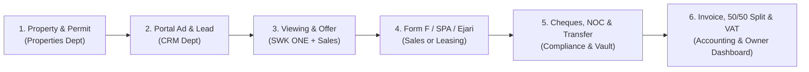

### 1.2 The 6 Protections Built for the Owner
Every screen in SWK Properties OS enforces six business protections automatically:

| Protection | How It Protects SWK Properties |
|---|---|
| **1. Brokers Only See Their Own Clients** | A sales or leasing broker can only view and edit leads, deals, and activities assigned to them. Only Managers and the Owner can see the entire company’s client list. |
| **2. Nothing Can Be Secretly Deleted** | When any staff member deletes a record, it is **not** erased. It moves to the **Delete Bin**, where only the Owner can permanently remove it or restore it with one click. |
| **3. Two-Person Sign-Off on Money & Permits** | The person who creates a property submission, commission payout, or refund request cannot approve their own request. A Manager or the Owner must sign off. |
| **4. Documents First, Advertising Second** | A property cannot be published to portals until the owner’s permit (Form A / Trakheesi) and title documents are attached and verified. |
| **5. Verified Office & Site Attendance** | Staff check in at the office by scanning the live **Reception QR** code on the reception screen, and brokers log GPS-verified site visits through the **SWK ONE** mobile app during scheduled appointments. |
| **6. Permanent Audit Trail** | Every sign-in, edit, approval, status change, and payout is stamped with the exact Dubai time and the name of the staff member who performed it. |

---

## Part 2 — How to Use Any Screen in 10 Seconds (The 4 Simple Rules)

You never need to memorize complicated menus. Every single screen in SWK Properties OS works the exact same way using four simple steps:

### Rule 1: Sign In at the Private Gate
Open the workspace address in your browser (or open the **SWK ONE** app on your phone). Enter your email and password and click **Sign in**.

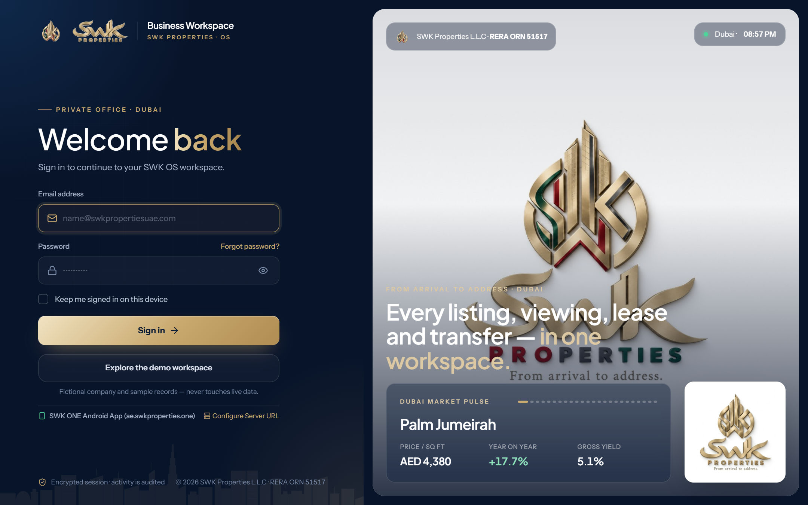

- **Left Side**: Your secure sign-in form. If two-factor security is enabled on your account, it will ask for the 6-digit code from your phone’s authenticator app.
- **Right Side**: Live Dubai time, RERA ORN 51517 identity, and the **Dubai Market Pulse** ticker showing current prices per sq ft and rental yields in prime Dubai communities.

---

### Rule 2: Start at the 12-Department Home Screen (“All Apps”)
Right after signing in, you land on the **All Apps Home Screen**.

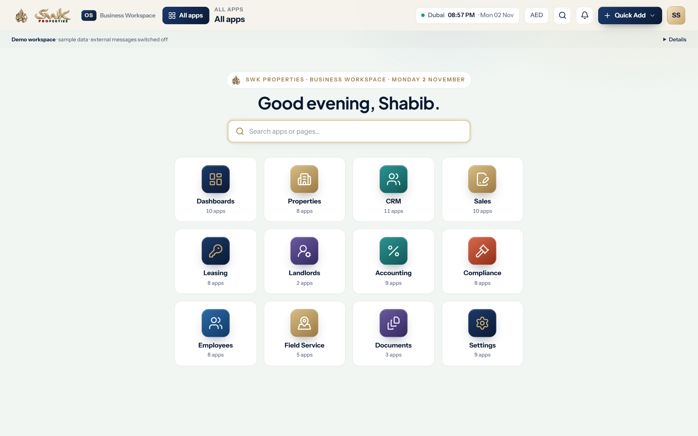

Think of this screen like the home screen of an iPhone or iPad:
- **12 Department Icons**: Every activity in your company belongs to one of these 12 icons (**Dashboards**, **Properties**, **CRM**, **Sales**, **Leasing**, **Landlords**, **Accounting**, **Compliance**, **Employees**, **Field Service**, **Documents**, **Settings**).
- **Search Bar in the Middle**: Type any word (for example, `"cheque"`, `"visa"`, `"Marina"`, or `"commission"`) and press **Enter** to jump straight to that page.
- **Recent Strip**: Shows the last pages you opened so you can return to them in one click.

---

### Rule 3: Follow the Numbered Steps (`1, 2, 3...`) Inside Any Department
When you click any department icon (for example, **Leasing** or **Sales**), the workspace opens that department and shows a **compact 2-column App-Icon Sidebar on the left**.

````carousel
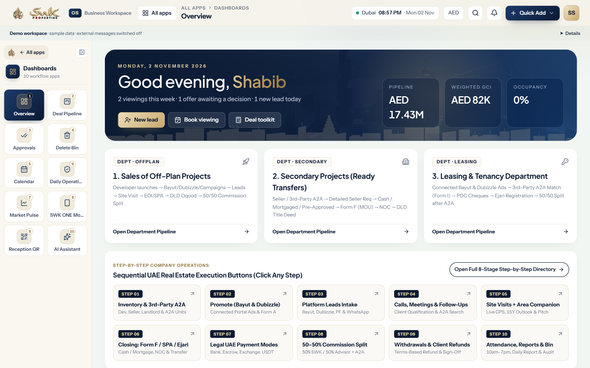
<!-- slide -->
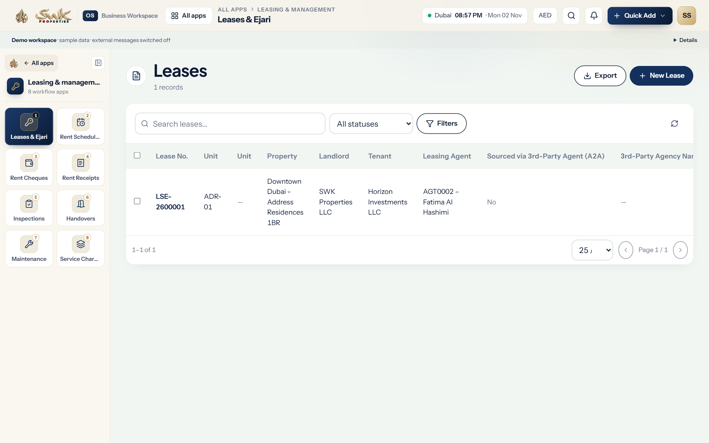
````

Look at the left sidebar in any department:
- Every icon has a **small step number (`1`, `2`, `3`, `4`...)** in its top-right corner.
- Why? Because the icons are arranged in the **exact order of real-world Dubai real estate work**.
  - For example, inside **Properties**, Step `1` is *New Submissions*, Step `2` is *Owner Permits*, Step `3` is *Properties*, Step `4` is *Units*, and Step `5` is *Listing Studio*.
  - Staff simply work from Step `1` to Step `2` to Step `3` without ever guessing what comes next.
- To return to the 12-department home screen at any time, click **All apps** at the top of the left sidebar or in the top bar.

---

### Rule 4: Use the Top Bar From Anywhere
Across the very top of every screen sits the permanent **Top Bar**:

| Top Bar Item | What It Does |
|---|---|
| **SWK Properties · OS Business Workspace** (Top Left) | Click the SWK logo at any time to return to the 12-Department Home Screen. |
| **All apps** Button | Takes you back to the 12-Department Home Screen. |
| **Breadcrumb & Page Title** | Tells you which department and page you are currently viewing (for example, `ALL APPS > LEASING & MANAGEMENT > Rent Cheques`). |
| **Dubai Clock & AED Badge** | Shows live Gulf Standard Time (`GST, UTC+4`) and confirms all figures are in UAE Dirhams (`AED`). |
| **Magnifying Glass (`Search`)** | Opens the instant global search box (or press `Ctrl + K` on your keyboard) to find any client, unit, lease, cheque, or invoice by name or number. |
| **Bell Icon (`Notifications`)** | Shows unread alerts (for example, a new approval waiting for your sign-off or a cheque due for deposit). |
| **`+ Quick Add` Button** | Lets you or your team create a **New Lead**, **Submit Property**, **Book Viewing**, **New Sale File**, **New Lease (Ejari)**, **Request NOC**, or **Daily Report** from any screen in two clicks. |
| **Initials Avatar (`SS`)** | Opens your account menu to change your password, switch language/preferences, open the Help Guide, install SWK OS as an app on your computer/phone, or sign out. |

---

## Part 3 — The Owner’s 5-Minute Morning Routine

As the Owner, you do not need to click through all 80 pages every day. You can review the entire company in **5 minutes each morning** using four screens inside **Dashboards**:

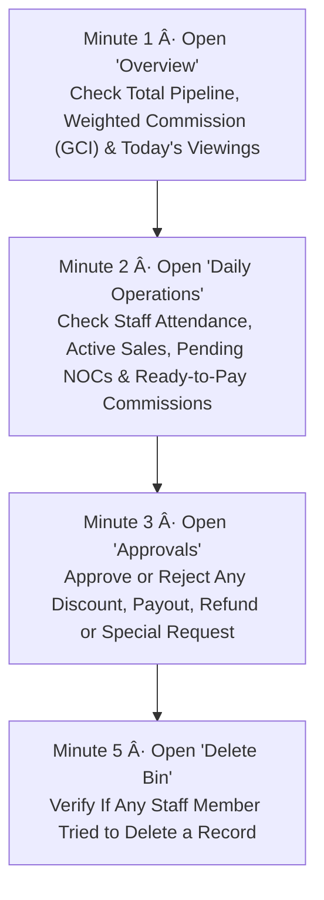

1. **Minute 1 — Open `Dashboards → Overview` (`Step 1`)**:
   - Check the dark blue executive banner at the top: it shows **Total Pipeline (AED)**, **Weighted GCI / Expected Commission (AED)**, **Portfolio Occupancy (%)**, and how many viewings, offers, and new leads arrived today.
2. **Minute 2 — Open `Dashboards → Daily Operations` (`Step 6`)**:
   - Check the 7 headline boxes: **Active Modules**, **Active Sales Pipeline**, **Collected Revenue**, **Approved Listings**, **Approved NOCs**, **Pending Approvals**, and **Open Compliance Cases**.
   - Click the tabs underneath (*Daily Work Reports*, *New Properties & Permits*, *Developer NOCs*, *Sales & Transfers*, *Commission Payouts*, *Visas & Agent Cards*) to inspect any department in detail without leaving the page.
3. **Minute 3 — Open `Dashboards → Approvals` (`Step 3`)**:
   - Review any item waiting for Owner or Manager sign-off and click **Approve** or **Reject**.
4. **Minute 5 — Open `Dashboards → Delete Bin` (`Step 4`)**:
   - See if any staff member deleted a lead, property, or document. Click **Restore** to put it back, or **Permanently Delete** if you agree it should be removed.

---

## Part 4 — Complete Department-by-Department Guide (All 12 Departments)

Below is the complete guide to all **12 Departments** and every tool inside them: what each screen is, why it is important for SWK Properties, and how to use it step by step.

---

### Department 1: Dashboards (Your Executive Command Centre)

**Purpose**: Gives the Owner and Management a live 360-degree view of revenue, pipeline, approvals, deleted items, market prices, and field operations.

````carousel

<!-- slide -->
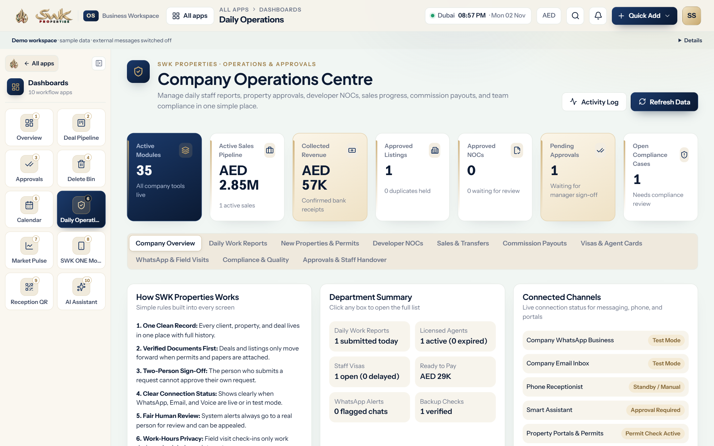
<!-- slide -->
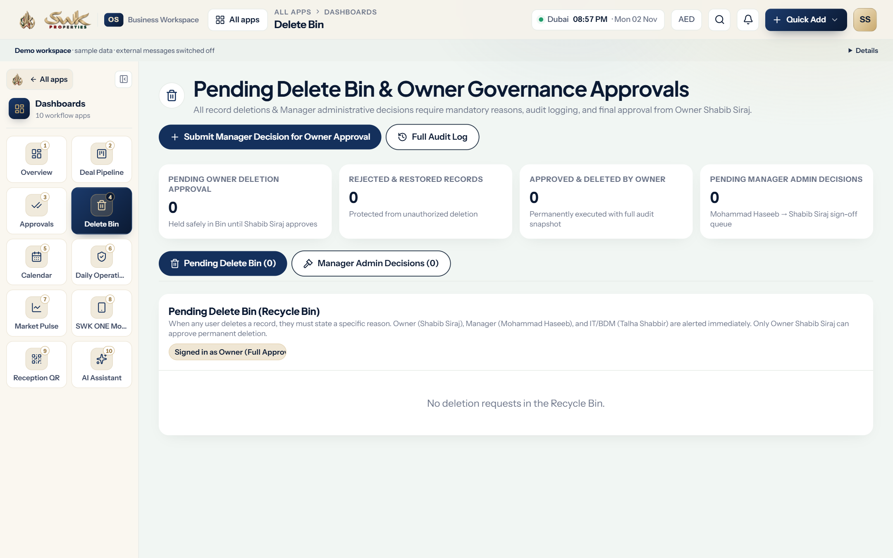
<!-- slide -->
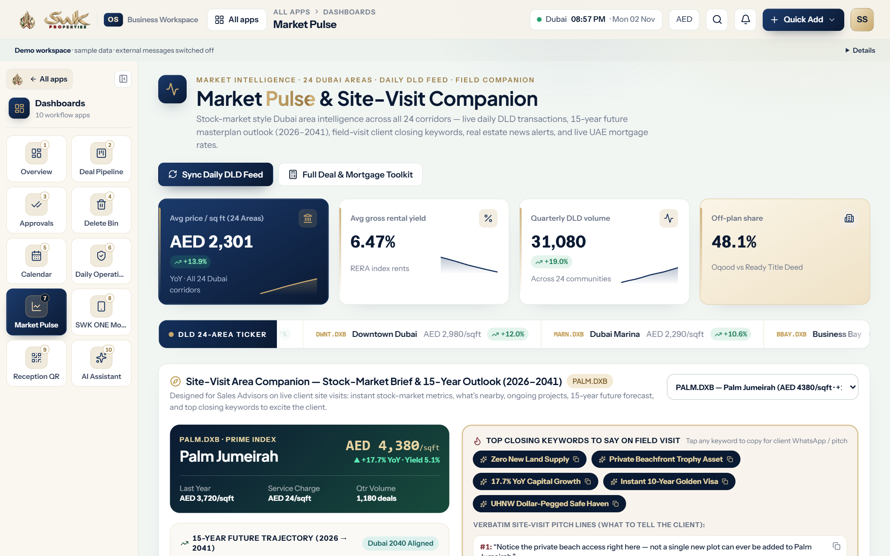
````

#### All 10 Icons Inside **Dashboards**:
| Step | App Icon | What It Does & Why It Matters | How to Use It |
|---|---|---|---|
| **1** | **Overview** | Your main morning summary. Shows total pipeline value, expected agency commission, department cards (*Off-Plan*, *Secondary*, *Leasing*), and 10 clickable step-by-step company execution buttons. | Click any of the 3 department cards or any of the 10 step buttons (`STEP 01` to `STEP 10`) to jump directly to that workflow. |
| **2** | **Deal Pipeline** | Visual board showing every active sale and lease deal from initial enquiry to closing. | Look across the columns to see which deals are stuck and which deals are ready to close this week. |
| **3** | **Approvals** | Central inbox for every request that requires Manager or Owner sign-off (commission releases, fee waivers, special terms). | Click any pending request, read the reason and attached documents, and click **Approve** or **Reject**. |
| **4** | **Delete Bin** | **Owner-only safety vault.** Whenever any user deletes a record anywhere in SWK OS, it is intercepted and held here. | Filter by module, inspect who deleted the record and when, then click **Restore to Workspace** or **Approve Permanent Delete**. |
| **5** | **Calendar** | Master company calendar showing property viewings, client meetings, cheque maturity dates, and lease renewals. | Switch between Day, Week, and Month views, or click **+ New Event** to schedule a viewing or meeting. |
| **6** | **Daily Operations** | **Company Operations Centre.** Combines 9 operational tabs in one screen: *Daily Work Reports*, *New Properties & Permits*, *Developer NOCs*, *Sales & Transfers*, *Commission Payouts*, *Visas & Agent Cards*, *WhatsApp & Field Visits*, *Compliance & Quality*, and *Approvals & Staff Handover*. | Click any tab across the middle bar to review live numbers and approve items on the spot. |
| **7** | **Market Pulse** | Live Dubai real estate benchmark tool showing average price per sq ft, year-on-year growth, gross rental yield, and transaction volume across major Dubai communities (Palm Jumeirah, Downtown Dubai, Dubai Marina, Business Bay, Dubai Hills, JVC, etc.). | Use this during landlord or buyer meetings to show objective Dubai Land Department market data and justify asking prices. |
| **8** | **SWK ONE Mobile** | Opens the live **SWK ONE** mobile companion interface right on your screen. | Preview what brokers see on their handsets, check live duty status, or test mobile check-ins. |
| **9** | **Reception QR** | Displays the live rotating security QR code for the office reception screen/iPad. | Leave this screen open on the reception tablet so staff can scan in at `10:00 AM` and scan out at `7:00 PM`. |
| **10** | **AI Assistant** | Smart internal business assistant connected to SWK Properties data. | Ask plain-English questions such as *"Which leases expire in the next 60 days?"* or *"Draft a polite follow-up email for a Downtown 2BR buyer."* |

---

### Department 2: Properties (8-Step Inventory & Portal Advertising)

**Purpose**: Controls every building, villa, apartment, commercial unit, owner permit, and portal advertisement so SWK Properties never advertises an unpermitted or duplicate unit.

````carousel
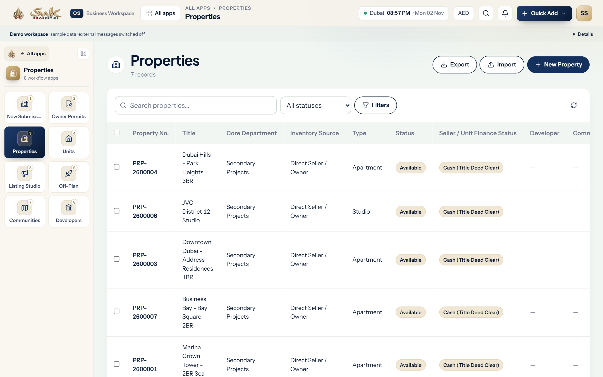
<!-- slide -->
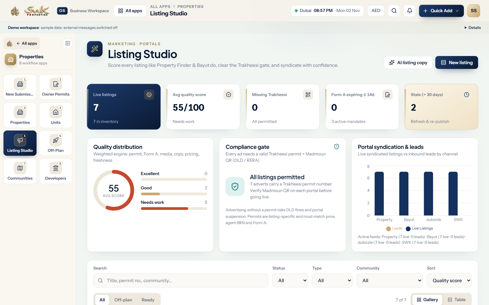
````

#### All 8 Icons Inside **Properties** (In Exact Workflow Order):
| Step | App Icon | What It Does & Why It Matters | How to Use It |
|---|---|---|---|
| **1** | **New Submissions** | Where brokers submit a newly sourced property from a seller, landlord, or 3rd-party agent (A2A). Prevents unverified properties from polluting your main database. | Broker clicks **+ New Submission**, enters owner details, asking price, and uploads the Title Deed & passport copy. Manager reviews and approves it. |
| **2** | **Owner Permits** | Tracks signed **RERA Form A** (seller/landlord marketing agreement) and **Trakheesi permit numbers** with expiry dates. | Before advertising any unit, record the Form A & Trakheesi permit here. The system alerts you before a permit expires. |
| **3** | **Properties** | Master directory of approved buildings, towers, and villa communities managed or marketed by SWK Properties. | Click **+ New Property** to add a building/project, or click any building row to see all units, documents, and history inside it. |
| **4** | **Units** | Individual apartments, villas, townhouses, and offices with bedroom count, size (sq ft), view, floor, parking, asking price/rent, and availability status (*Available*, *Reserved*, *Sold*, *Leased*). | Filter by community, bedrooms, or status when a client calls, or click any unit to view its owner, price, and photos. |
| **5** | **Listing Studio** | Your advertising control room for **Bayut**, **Dubizzle**, and **Property Finder**. Checks that photos, descriptions, and Trakheesi permits are complete before publishing. | Select an approved unit, write the English/Arabic marketing headline, verify the Trakheesi QR/permit badge, and toggle the portal switches to publish. |
| **6** | **Off-Plan** | Dedicated launch catalogue for new developer projects (Emaar, DAMAC, Sobha, Nakheel, Meraas, Binghatti, etc.) with payment plans (e.g., `60/40`, `80/20`), handover dates, and commission rates. | Open during investor meetings to compare developer payment plans, floor plans, and booking EOI deadlines. |
| **7** | **Communities** | Master list of Dubai areas and districts with service charge benchmarks and area guides. | Keep community profiles updated so listings and market reports stay accurate. |
| **8** | **Developers** | Directory of UAE master developers, their primary sales contacts, commission terms, and NOC fee rules. | Reference when requesting Developer NOCs or registering off-plan bookings. |

---

### Department 3: CRM (11-Step Client, Call, WhatsApp & Lead Engine)

**Purpose**: Captures every buyer, seller, landlord, and tenant enquiry from property portals, WhatsApp, phone calls, and walk-ins—and ensures every lead is followed up on time.

> [!IMPORTANT]
> **Client Privacy Protection**: Inside the CRM, each broker only sees the leads and clients assigned to them. The Owner and Managers see all leads across the company and can reassign a lead in one click if a broker is slow to respond.

````carousel
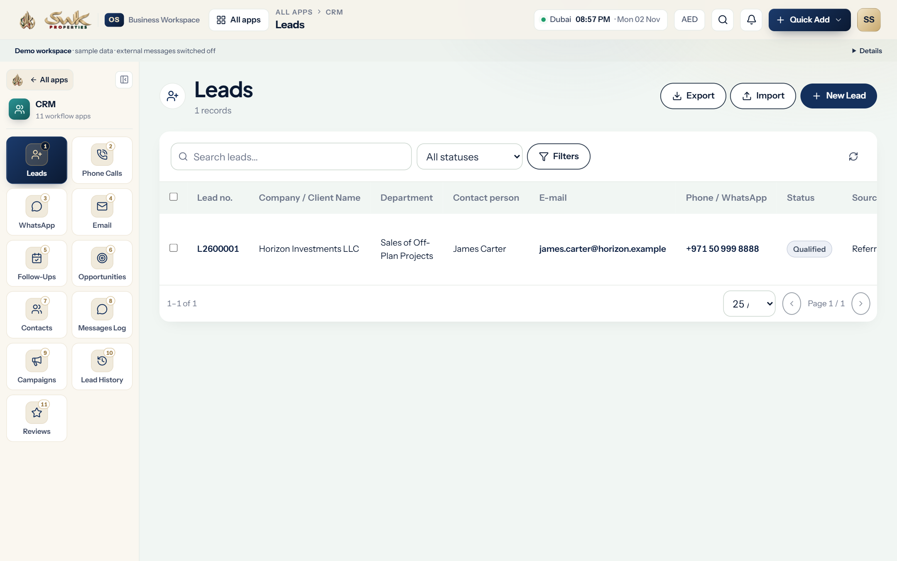
<!-- slide -->
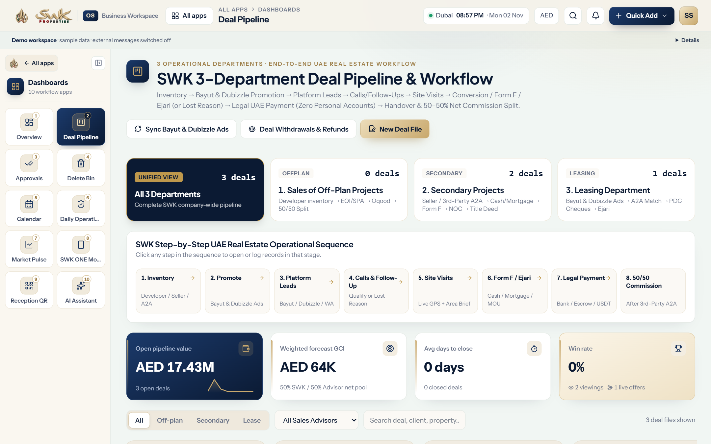
````

#### All 11 Icons Inside **CRM**:
| Step | App Icon | What It Does & Why It Matters | How to Use It |
|---|---|---|---|
| **1** | **Leads** | Every new enquiry from Bayut, Dubizzle, Property Finder, social ads, website, or referrals lands here with source, budget, preferred area, and assigned broker. | Click **+ New Lead** to log an enquiry, or click any lead to update its status (*New* → *Contacted* → *Qualified* → *Viewing Booked* → *Converted*). |
| **2** | **Phone Calls** | Log of all inbound and outbound client phone calls, duration, outcome, and call notes. | Brokers log every call here so if a client calls the office later, anyone with permission can see what was discussed. |
| **3** | **WhatsApp** | Company WhatsApp Business conversation centre linked to client records. | Send property brochures, location pins, and viewing confirmations directly from the workspace while keeping chat history inside the company. |
| **4** | **Email** | Client email inbox and outbound templates for formal offers, viewing schedules, and statements. | Send and track formal emails attached directly to the client’s file. |
| **5** | **Follow-Ups** | Scheduled tasks, callbacks, and reminders so no hot lead is ever forgotten. | Check overdue follow-ups in red; brokers mark tasks complete as they finish their daily calls. |
| **6** | **Opportunities** | Qualified buyer or tenant requirements (exact budget, bedroom count, cash vs. mortgage, move-in date, and matched units). | Convert a serious Lead into an Opportunity to track it on the Deal Pipeline board. |
| **7** | **Contacts** | Master directory of verified Buyers, Sellers, Landlords, Tenants, and Co-Brokers (A2A) with Emirates ID / Passport expiry tracking. | Search any client name or phone number to see every property they own, rent, or have enquired about. |
| **8** | **Messages Log** | Complete chronological archive of all SMS, WhatsApp, and email communications sent by the system. | Useful for resolving any client dispute ("When did we send the renewal notice?"). |
| **9** | **Campaigns** | Tracks marketing campaigns (Instagram/Google ads, portal featured boosts, roadshows, SMS blasts), cost spent, and how many leads and deals each campaign generated. | Check which marketing channel gives SWK Properties the highest return on investment. |
| **10** | **Lead History** | Audit trail showing when each lead arrived, which broker received it first, and if/when it was reassigned. | Eliminates internal disputes between brokers over "who owned the lead first." |
| **11** | **Reviews** | Post-transaction client satisfaction ratings and quality-assurance scores. | Monitor service quality and spot any broker who needs coaching. |

---

### Department 4: Sales & Mandates (10-Step Secondary & Off-Plan Sales)

**Purpose**: Guides every property sale from the Seller’s Form A agreement all the way through Form F (MOU), Escrow deposit, Developer NOC, Dubai Land Department (DLD) Trustee transfer, and Deal Folder closing—plus safe handling of deal cancellations and refunds.

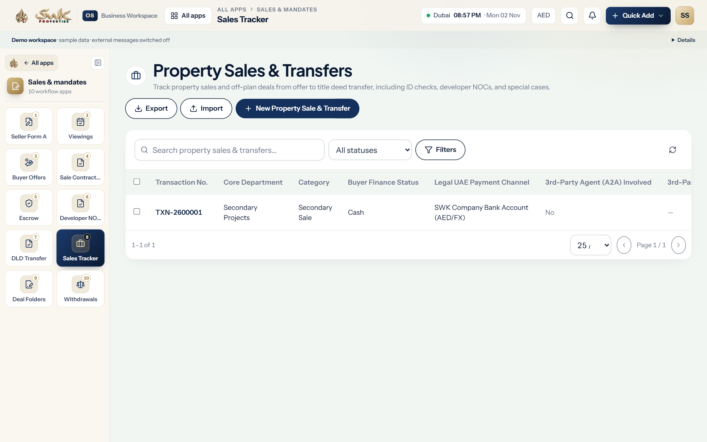

#### All 10 Icons Inside **Sales & Mandates**:
| Step | App Icon | What It Does & Why It Matters | How to Use It |
|---|---|---|---|
| **1** | **Seller Form A** | RERA Seller Marketing Agreement between the property owner and SWK Properties (standard or exclusive mandate, agreed commission %, asking price, and validity dates). | Create Form A before marketing any resale property; attach the signed Form A PDF. |
| **2** | **Viewings** | Schedules and logs physical property viewings with buyer feedback and broker attendance. | Click **+ New Viewing**, select the unit, client, broker, and date/time. After the visit, record the client’s feedback (*Interested*, *Offer Coming*, *Too Small*, etc.). |
| **3** | **Buyer Offers** | Formal log of every purchase offer submitted by a buyer (price offered, payment mode: *Cash*, *Mortgage Pre-Approved*, *Bank Transfer*, *Manager’s Cheque*, or *Licensed Crypto/VARA*, deposit %, and conditions). | Log every offer and counter-offer in writing so the seller sees a clear negotiation history. |
| **4** | **Sale Contract (F)** | **RERA Form F (MOU)** — the binding sale contract between Buyer and Seller once an offer is accepted. | Generate and track Form F signing dates, 10% security deposit cheque status, and mortgage valuation deadlines. |
| **5** | **Escrow** | Tracks security deposits and escrow account balances held for active sales or off-plan bookings. | Record when the 10% deposit cheque is received in the safe and when it is released at transfer. |
| **6** | **Developer NOC** | **No Objection Certificate** tracker with the master developer (Emaar, DAMAC, Nakheel, etc.) confirming all service charges are paid before transfer. | Log the NOC application date, developer appointment date, service-charge clearance, and uploaded NOC certificate. |
| **7** | **DLD Transfer** | Tracks the final transfer appointment at the **Dubai Land Department Registration Trustee office** (4% DLD fee, manager’s cheques, new Title Deed / Oqood issuance). | Mark the DLD Transfer complete and upload the new Title Deed number to unlock final commission invoicing. |
| **8** | **Sales Tracker** | Master table of all ongoing sales transactions showing exact stage, value, buyer, seller, and expected closing date. | Your single screen to see every sale currently in progress across SWK Properties. |
| **9** | **Deal Folders** | Complete closing file for each deal linking the unit, buyer, seller, Form A, Form F, NOC, Title Deed, invoice, and broker commission split. | Open a Deal Folder before approving a broker’s commission payout to verify every paper is complete. |
| **10** | **Withdrawals** | **Deal Cancellations, Client Withdrawals & Refunds.** When a buyer or tenant withdraws from a booking or deal, this module calculates any retention/deduction per contract terms and routes the refund through a multi-step approval gate. | Review the withdrawal reason, contract terms, and net refund amount before signing off on any refund payment. |

---

### Department 5: Leasing & Management (8-Step Ejari, Cheques & Maintenance)

**Purpose**: Runs the entire residential and commercial leasing business—from signing the Ejari tenancy contract and storing post-dated rent cheques (PDCs) in the vault, to move-in inspections, key handovers, and repair requests.

````carousel

<!-- slide -->
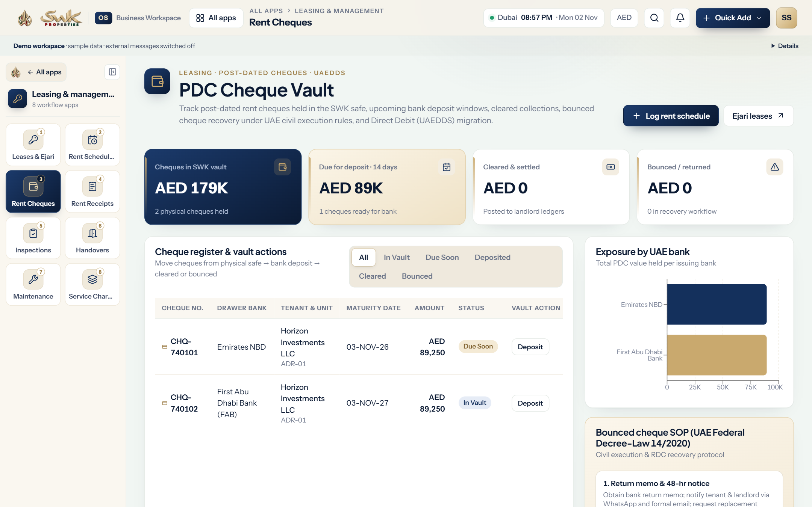
````

#### All 8 Icons Inside **Leasing & Management**:
| Step | App Icon | What It Does & Why It Matters | How to Use It |
|---|---|---|---|
| **1** | **Leases & Ejari** | Master register of all tenancy contracts, Ejari numbers, start/end dates, annual rent, security deposit, number of cheques (`1`, `2`, `4`, `6`, or `12`), and 90-day RERA renewal notice alerts. | Click **+ New Lease** when a tenant signs. The system automatically tracks when the lease is approaching the 90-day RERA notice window. |
| **2** | **Rent Schedules** | Breaks each annual lease into individual rent instalment dates (for example, 4 quarterly payments) and shows whether each instalment is *Upcoming*, *Due Soon*, *Paid*, or *Overdue*. | Filter by *Due Soon* or *Overdue* to see which tenants need a payment reminder this week. |
| **3** | **Rent Cheques** | **PDC Cheque Vault.** Tracks every physical post-dated cheque held in the SWK safe: cheque number, bank name (Emirates NBD, FAB, ADCB, Mashreq, etc.), maturity date, amount, and status (*In Vault* → *Due Soon* → *Deposited* → *Cleared* or *Bounced*). Also includes the step-by-step UAE Federal Decree-Law 14/2020 protocol for bounced cheques. | Check the **Due for deposit · 14 days** box each morning; click **Deposit** when a cheque is sent to the bank, and **Cleared** once funds arrive. |
| **4** | **Rent Receipts** | Official numbered receipts issued to tenants whenever a rent cheque clears or a bank transfer is received. | Click any cleared payment to print or email the official SWK Properties rent receipt. |
| **5** | **Inspections** | Move-in, routine, and move-out property condition reports (walls, AC, appliances, meter readings, photos) used to decide security deposit deductions. | Complete a Move-In Inspection before handing over keys, and a Move-Out Inspection before refunding the tenant’s security deposit. |
| **6** | **Handovers** | Tracks physical keys, access cards, parking remotes, and DEWA/chiller clearance during tenant move-in or move-out. | Record how many keys and access cards were given to the tenant and get their signature. |
| **7** | **Maintenance** | Property repair and work-order tracker (AC servicing, plumbing, electrical, painting). Tracks whether the cost is covered by the Landlord, Tenant, or Building Warranty. | Log tenant maintenance requests, assign a contractor, approve the quote, and deduct approved landlord repairs from the landlord’s statement. |
| **8** | **Service Charges** | Tracks RERA Mollak building service charges per sq ft for managed units so landlords know their true net yield. | Record quarterly service charge bills for managed properties. |

---

### Department 6: Landlords (Owner Portfolios & Payout Statements)

**Purpose**: Gives property owners who entrust their buildings or units to SWK Properties transparent, institutional-grade reporting on their gross rent, maintenance deductions, management fees, and net payouts.

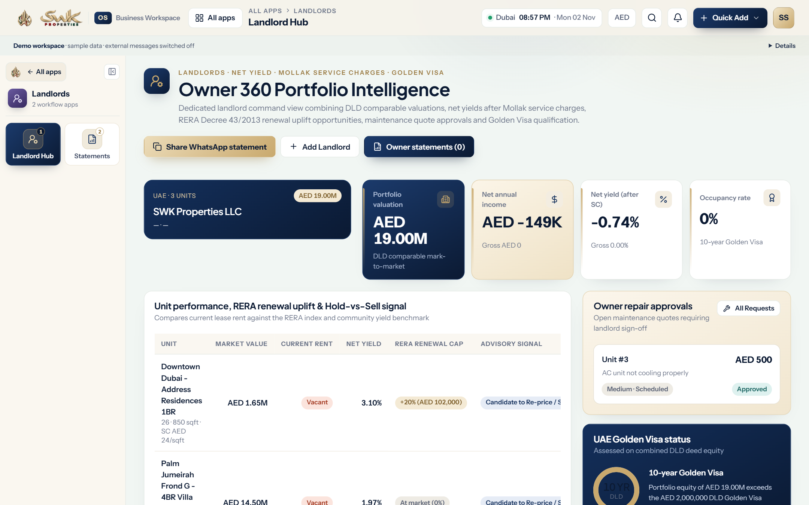

#### Both Icons Inside **Landlords**:
| Step | App Icon | What It Does & Why It Matters | How to Use It |
|---|---|---|---|
| **1** | **Landlord Hub** | Shows every landlord’s complete property portfolio: total units owned, occupancy rate, gross rent collected, maintenance expenses, and net yield %. | Open a landlord’s profile before calling them to see all their units, active tenants, and upcoming cheque dates in one place. |
| **2** | **Statements** | Generates formal **Owner Payout Statements** showing: `Collected Rent − SWK Management Fee − Approved Maintenance Bills = Net Landlord Payout`. | Generate monthly or quarterly statements, export to PDF, and record the bank transfer payout to the landlord. |

---

### Department 7: Accounting (9-Step Invoices, 50/50 Commissions & VAT)

**Purpose**: Manages every Dirham coming into and going out of SWK Properties—client tax invoices, payment receipts, the **50% Company / 50% Broker commission split** (and 3rd-party A2A co-broker splits), supplier bills, bank reconciliation, Profit & Loss, and UAE 5% VAT returns.

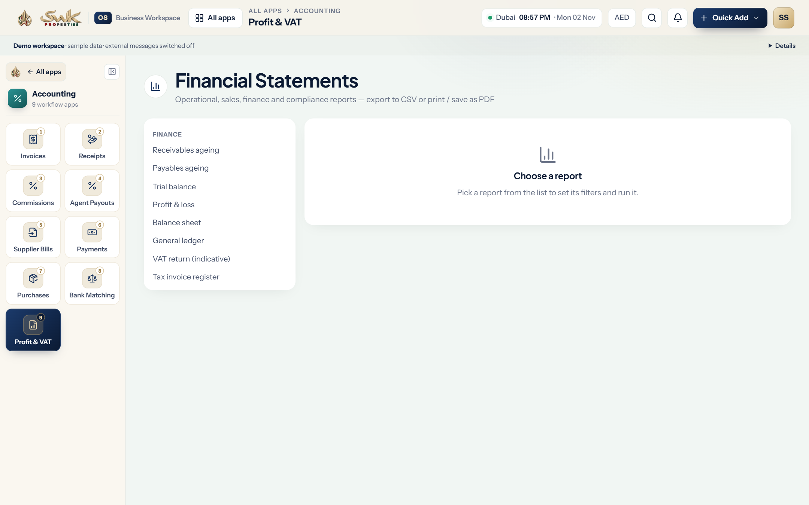

#### How SWK Commission Math Works Automatically:
Whenever a deal closes:
1. If a **3rd-Party Agent (A2A)** was involved (RERA Form I), their agreed share is deducted first from the gross commission.
2. The remaining **Net Agency Commission** is split **50% to SWK Properties** and **50% to the closing SWK Property Advisor** (or according to the broker’s contract tier).
3. A broker commission is only marked **Ready to Pay** after the client’s payment has **actually cleared into the SWK bank account**.

#### All 9 Icons Inside **Accounting**:
| Step | App Icon | What It Does & Why It Matters | How to Use It |
|---|---|---|---|
| **1** | **Invoices** | Creates FTA-compliant **UAE Tax Invoices** (with TRN and 5% VAT) for sales brokerage commissions, leasing fees, developer commissions, and management fees. | Click **+ New Invoice** when a deal closes, or generate it directly from the Deal Folder. |
| **2** | **Receipts** | Logs every incoming payment received from buyers, sellers, tenants, or developers (Bank Transfer, Manager’s Cheque, Cash, Escrow, etc.). | Record a Receipt against an Invoice as soon as the money hits the bank. |
| **3** | **Commissions** | Calculates each broker’s commission share on closed deals (including 50/50 split and any A2A external broker split). | Review the calculated split and verify that the client invoice is paid before approving. |
| **4** | **Agent Payouts** | Tracks approved broker commission entitlements waiting for bank transfer. | Owner/Finance approves the payout and marks it paid once transferred to the broker. |
| **5** | **Supplier Bills** | Tracks incoming bills from property portals (Bayut, Dubizzle, Property Finder), office rent, DEWA, telecommunications, and maintenance contractors. | Log every supplier bill with its due date and input VAT so nothing is paid twice or late. |
| **6** | **Payments** | Records all outgoing bank transfers and cheque payments made by SWK Properties. | Every outgoing payment requires proper authorization and links to a bill, refund, or commission payout. |
| **7** | **Purchases** | Staff requests for office equipment, marketing materials, or software subscriptions. | Staff submit a purchase request here; the Owner approves it before money is spent. |
| **8** | **Bank Matching** | Matches your bank statement lines against recorded Receipts and Payments so your book balance equals your real bank balance. | Reconcile bank lines weekly to spot any missing receipt or unexpected bank charge immediately. |
| **9** | **Profit & VAT** | Live **Income Statement (Profit & Loss)**, **Balance Sheet**, **Trial Balance**, and **UAE FTA 5% VAT Return Box Summary** (Output VAT collected minus Input VAT paid = Net VAT Payable). | Open anytime to see true net company profit or to prepare the quarterly UAE Federal Tax Authority VAT filing. |

---

### Department 8: Compliance (RERA, Trakheesi, KYC & Anti-Money Laundering)

**Purpose**: Protects SWK Properties L.L.C (`RERA ORN 51517`) from regulatory fines by tracking every RERA form, Trakheesi permit, broker BRN card expiry, client KYC identity check, and UAE Ministry of Economy Anti-Money Laundering (goAML) requirement.

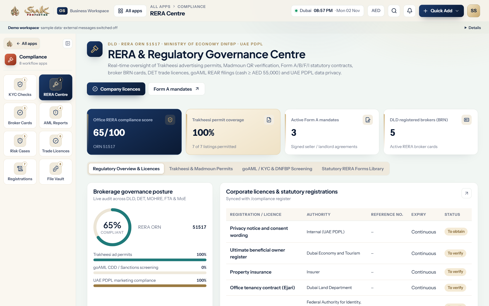

#### All 8 Icons Inside **Compliance**:
| Step | App Icon | What It Does & Why It Matters | How to Use It |
|---|---|---|---|
| **1** | **KYC Checks** | **Know Your Customer (KYC)** verification for buyers, sellers, and corporate entities (Passport, Emirates ID, Trade Licence, Ultimate Beneficial Owner, Sanctions/PEP check). | Complete a KYC check on every sale buyer and seller before signing Form F or accepting funds. |
| **2** | **RERA Centre** | Central hub for **Trakheesi marketing permits**, **RERA Form A** (seller agreement), **Form B** (buyer agent agreement), **Form I** (agent-to-agent co-brokering agreement), and **Form F** (sale MOU). | Verify that every active listing has a valid Trakheesi permit and check upcoming permit expiries. |
| **3** | **Broker Cards** | Tracks every SWK broker’s **RERA Broker Registration Number (BRN)** card issue date, expiry date, and renewal status. | Check 60 days before a broker’s BRN expires so their RERA card is renewed without interruption. |
| **4** | **AML Reports** | Tracks UAE **goAML** filings (Suspicious Transaction Reports / Cash or Virtual Asset Real Estate Transaction Reports as required by UAE AML law). | Used by the Compliance Officer and Owner to log and review high-value cash or crypto property transactions. |
| **5** | **Risk Cases** | Internal compliance investigations, client complaints, or flagged transactions requiring senior review. | Review open cases, attach findings, and record the final decision. |
| **6** | **Trade Licences** | Tracks SWK Properties’ **DED Trade Licence**, **RERA ORN 51517 Certificate**, **Chamber of Commerce**, **Establishment Card**, and **Professional Indemnity Insurance** renewal dates. | Gives early countdown warnings so company licences never lapse. |
| **7** | **Registrations** | Repository of official government registrations (DLD, Ejari, FTA Tax Registration Number, MOHRE, WPS). | Keep official registration numbers and certificates accessible in one place. |
| **8** | **File Vault** | Central searchable document vault for all uploaded contracts, IDs, deeds, and NOCs across the company. | Filter by document category or expiry date to find any file in seconds. |

---

### Department 9: Employees (Brokers, Visas, Attendance & WPS Salaries)

**Purpose**: Manages the entire SWK Properties team—staff profiles, broker BRN cards, joining & exit checklists, UAE residence visas and Emirates IDs, daily `10:00 AM – 7:00 PM` attendance, leave requests, monthly UAE WPS payroll, and the Broker Leaderboard.

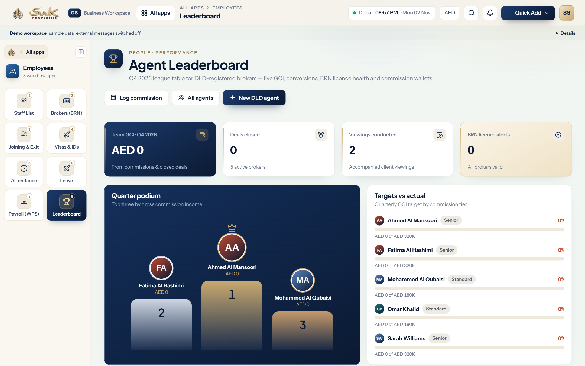

#### All 8 Icons Inside **Employees**:
| Step | App Icon | What It Does & Why It Matters | How to Use It |
|---|---|---|---|
| **1** | **Staff List** | Complete directory of all SWK employees (department, job title, joining date, salary structure, emergency contact, and contract type). | Click **+ New Employee** when hiring, or open any staff profile to view their documents and attendance. |
| **2** | **Brokers (BRN)** | Dedicated roster of Sales & Leasing Advisors showing their RERA BRN number, specialist Dubai communities, commission split %, and active listings count. | Assign communities and monthly targets to each broker. |
| **3** | **Joining & Exit** | Step-by-step onboarding checklist for new hires (SIM card, email, laptop, RERA exam, visa, SWK ONE app) and offboarding clearance when a staff member leaves (returning keys, laptops, reassigning leads, visa cancellation). | Never allow a departing employee’s visa cancellation or final settlement to complete until their leads, keys, and devices are handed over. |
| **4** | **Visas & IDs** | Tracks every employee’s **UAE Residence Visa**, **MOHRE Labour Card / Work Permit**, **Emirates ID**, **Medical Insurance**, and **Passport** expiry dates. | Alerts HR and the Owner 60 days before any staff visa or Emirates ID expires to avoid overstay fines. |
| **5** | **Attendance** | Daily staff attendance register (`10:00 AM to 7:00 PM` Dubai office hours) showing check-in time, check-out time, verification method (Reception QR / GPS), and late arrivals. | Review who arrived on time today, who is out on a verified client viewing, and who was late or absent. |
| **6** | **Leave** | Annual leave, sick leave, and maternity/emergency leave requests with balance tracking under UAE Labour Law. | Staff submit leave requests with dates; Manager/Owner approves after checking that their active leads are covered. |
| **7** | **Payroll (WPS)** | Monthly salary calculation combining Basic Salary + Allowances + Approved Commissions − Unpaid Leave/Advances, ready for **UAE Wage Protection System (WPS) SIF file** bank upload. | Generate monthly payslips, review total payroll cost, and approve the WPS salary batch. |
| **8** | **Leaderboard** | Live ranking of SWK brokers by closed deal volume, gross commission generated (GCI), viewings completed, and conversion rate. | Use in weekly Monday morning sales meetings to recognize top performers and motivate the team. |

---

### Department 10: Field Service (SWK ONE Mobile App & Office Reception QR)

**Purpose**: Connects your field brokers and office reception directly to SWK Properties OS in real time.

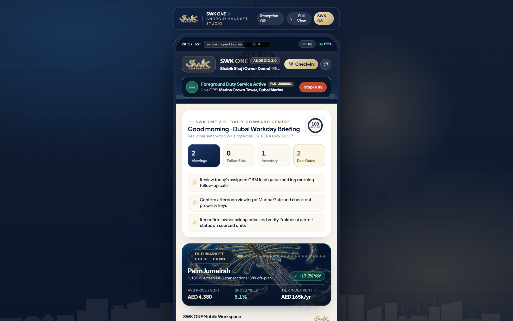

#### How SWK ONE & Reception QR Work Together:
1. **Morning Arrival (`10:00 AM`)**: A tablet or screen at the office reception displays the **Reception QR** page. Because the QR code refreshes automatically every few seconds, nobody can take a photo of it and scan from home. Staff open **SWK ONE** on their phone and scan the Reception QR to check in.
2. **During the Day (Client Site Visits)**: When a broker goes to a property viewing or developer meeting (for example, at Dubai Marina or Downtown Dubai), they tap **Start Field Visit** in **SWK ONE**. The app logs their GPS location at the building, gives them a live **Area Companion** (showing 15-year community price trends and rental yields to share with the client), and records the viewing outcome.
3. **Evening Departure (`7:00 PM`)**: Before leaving, every broker and staff member submits their **Daily Report** summarizing calls made, viewings completed, offers received, and tomorrow’s plan, then scans out at reception.

#### All 5 Icons Inside **Field Service**:
| Step | App Icon | What It Does & Why It Matters | How to Use It |
|---|---|---|---|
| **1** | **SWK ONE App** | Opens the full **SWK ONE Mobile Workspace** (also installable as a native Android APK `ae.swkproperties.one` or iPhone web app). | Staff use this on their phones for QR check-in, leads, viewings, area price companion, and daily reports. |
| **2** | **Reception QR** | Full-screen rotating security QR display for the SWK office entrance. | Open on the reception iPad/monitor in full-screen mode. |
| **3** | **Gate Logs** | Chronological log of every office arrival and exit scan with timestamp and device verification. | Check exact arrival and departure times for any date. |
| **4** | **Field Visits** | Live and historical log of all broker GPS site visits outside the office, including building visited, client met, and duration. | Verify that brokers who were out of the office were at genuine client viewings. |
| **5** | **Daily Reports** | End-of-day work summaries submitted by every staff member before `7:00 PM`. | Review what each team member accomplished today in one clean list. |

---

### Department 11: Documents (Instant Deal Calculators, Letter Studio & Reports)

**Purpose**: Gives brokers and management instant financial calculators for client meetings, standardized company contract templates, and custom Excel/PDF business reports.

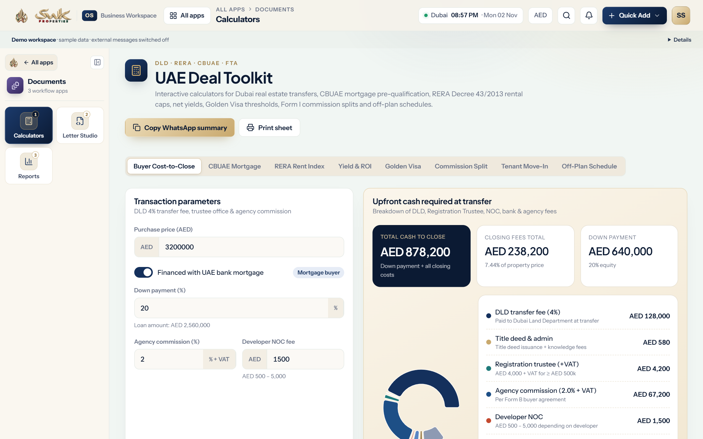

#### All 3 Icons Inside **Documents**:
| Step | App Icon | What It Does & Why It Matters | How to Use It |
|---|---|---|---|
| **1** | **Calculators** | ** UAE Deal Toolkit.** Includes 4 instant calculators on one screen:<br>1. **DLD Transfer Cost Calculator** (calculates the exact 4% DLD transfer fee + Trustee fee + Title Deed fee + 2% agency commission + 5% VAT).<br>2. **UAE Mortgage Calculator** (down payment %, interest rate, monthly AED instalment).<br>3. **Net Rental Yield & ROI Calculator** (gross rent minus service charges = true net yield %).<br>4. **Commission Split Calculator** (calculates 3rd-party A2A deduction and 50/50 SWK vs. Advisor split). | Enter the property price or rent during a client call to give the buyer or investor an exact, dirham-accurate cost breakdown in 5 seconds. |
| **2** | **Letter Studio** | Pre-formatted SWK Properties letterheads, offer letters, reservation receipts, landlord notices, and NOC request templates. | Select a template, fill in the client/property details, and print or export to PDF with official SWK branding. |
| **3** | **Reports** | Custom report builder and one-click CSV/Excel exports across Sales, Leasing, CRM, Accounting, and HR. | Select any department and date range to download a clean spreadsheet for your external auditor or board review. |

---

### Department 12: Settings (Company Profile, Permissions, Backups & Audit Trail)

**Purpose**: The Owner’s control room for company details, office geofences, staff access permissions, approval limits, portal/WhatsApp integrations, database backups, and the security audit trail.

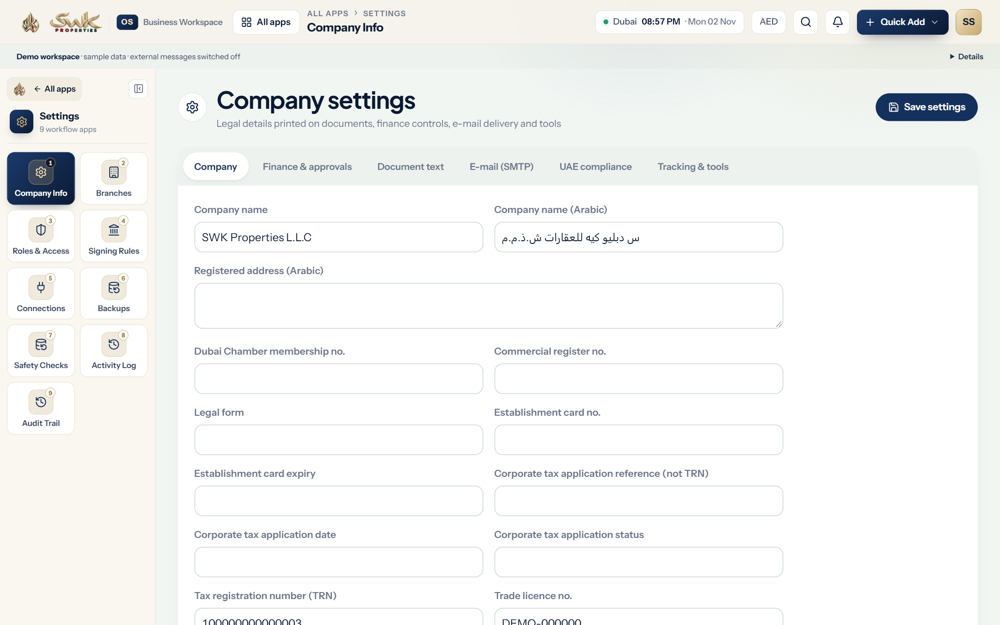

#### All 9 Icons Inside **Settings**:
| Step | App Icon | What It Does & Why It Matters | How to Use It |
|---|---|---|---|
| **1** | **Company Info** | Official company name (`SWK Properties L.L.C`), RERA ORN (`51517`), Tax Registration Number (TRN), address, phone, email, and bank account details printed on invoices. | Update whenever company contact details or bank IBANs change. |
| **2** | **Branches** | Office locations and GPS geofence coordinates (radius in meters) used to verify office attendance scans. | Add or update office coordinates so attendance scans only work inside the office radius. |
| **3** | **Roles & Access** | Defines exactly what each role (**Owner / Admin**, **Sales Manager**, **Sales / Leasing Broker**, **Accountant**, **HR / Operations**, **Compliance Officer**) can **View**, **Create**, **Edit**, **Approve**, or **Export**. | Review or adjust role permissions at any time. |
| **4** | **Signing Rules** | Corporate governance rules and financial approval thresholds (for example, any refund or payout above a set AED limit requires Owner sign-off). | Set the exact Dirham limits that require your personal approval. |
| **5** | **Connections** | Configuration for external services: Bayut/Dubizzle XML feeds, Property Finder API, WhatsApp Business API, and company SMTP email. | Check whether each external connection is in *Live Mode* or *Test Mode*. |
| **6** | **Backups** | One-click full database backup download and restore utility. | Download a complete encrypted snapshot of your company data at any time for safekeeping. |
| **7** | **Safety Checks** | Disaster-recovery check logs verifying that backups can be restored cleanly. | Confirm periodic backup verification status. |
| **8** | **Activity Log** | Security event log showing all user logins, failed password attempts, permission changes, and data exports. | Inspect if you ever want to see when a user signed in or exported a report. |
| **9** | **Audit Trail** | Field-by-field history of every record change in the system (shows the **Old Value**, the **New Value**, **Who Changed It**, and **Exact Timestamp**). | Search any record ID to see its complete life history from creation to today. |

---

## Part 5 — Four End-to-End Business Playbooks (How Daily Work Flows)

To make training your team effortless, here is how the four main workflows operate from start to finish inside **SWK Properties OS**:

### Playbook A: Selling a Secondary or Off-Plan Property (Start to Finish)
1. **Source the Unit (`Properties → Step 1: New Submissions`)**: Broker submits the seller’s unit (or selects a unit from a 3rd-party A2A agent).
2. **Sign the Seller Permit (`Sales → Step 1: Seller Form A`)**: Attach the signed RERA Form A and Trakheesi permit number.
3. **Publish the Ad (`Properties → Step 5: Listing Studio`)**: Publish the verified listing to Bayut and Dubizzle.
4. **Capture & Qualify the Buyer (`CRM → Step 1: Leads` & `Step 2: Phone Calls`)**: When the buyer enquires, the assigned broker logs the call, qualifies whether they are a **Cash Buyer**, **Mortgage Pre-Approved Buyer**, or **Off-Plan Investor**, and matches suitable units.
5. **Conduct the Viewing (`Field Service → Step 1: SWK ONE App` & `Sales → Step 2: Viewings`)**: Broker meets the buyer at the property, checks in via GPS on **SWK ONE**, uses the **Area Companion** to show community price growth, and logs the viewing feedback.
6. **Log the Offer & Sign Form F (`Sales → Step 3: Buyer Offers` & `Step 4: Sale Contract (F)`)**: Once the seller accepts the offer, generate RERA Form F (or developer SPA for off-plan) and log the 10% security deposit in `Step 5: Escrow`.
7. **Complete KYC & Developer NOC (`Compliance → Step 1: KYC Checks` & `Sales → Step 6: Developer NOC`)**: Compliance verifies buyer/seller IDs; Operations tracks the Developer NOC clearance.
8. **Transfer at DLD Trustee (`Sales → Step 7: DLD Transfer`)**: Log the completed Title Deed / Oqood transfer and payment mode (*Bank Transfer*, *Manager’s Cheque*, *Escrow*, or *Licensed VARA Crypto*).
9. **Invoice & Pay 50/50 Commission (`Accounting → Step 1: Invoices` → `Step 2: Receipts` → `Step 3: Commissions`)**: Issue the tax invoice, record the bank receipt once funds clear, deduct any A2A partner share, and release the **50% SWK / 50% Advisor** commission split.

---

### Playbook B: Leasing a Property & Managing Post-Dated Cheques (Start to Finish)
1. **List & Show the Unit (`Properties` → `CRM` → `Viewings`)**: Market the landlord’s unit on Bayut/Dubizzle (or co-broker via RERA Form I if sourced through a 3rd-party A2A agent).
2. **Create the Tenancy & Ejari (`Leasing → Step 1: Leases & Ejari`)**: Enter the tenant, landlord, unit, start/end dates, annual rent, security deposit, and number of cheques.
3. **Generate Rent Schedule & Store Cheques (`Leasing → Step 2: Rent Schedules` & `Step 3: Rent Cheques`)**: Log each post-dated cheque into the **PDC Cheque Vault** with cheque number, bank, maturity date, and amount.
4. **Move-In Inspection & Key Handover (`Leasing → Step 5: Inspections` & `Step 6: Handovers`)**: Complete the condition report, record key counts, and hand over the apartment.
5. **Deposit Cheques on Maturity (`Leasing → Step 3: Rent Cheques` → `Step 4: Rent Receipts`)**: Every morning, the PDC Vault highlights cheques maturing within 14 days. Deposit the cheque, mark it *Cleared*, issue the tenant’s **Rent Receipt**, and update the **Landlord Statement** (`Landlords → Step 2: Statements`).

---

### Playbook C: Daily Staff Attendance, Site Visits & End-of-Day Reporting (`10:00 AM – 7:00 PM`)
1. **10:00 AM Check-In (`Field Service → Step 2: Reception QR`)**: Staff arrive at the office and scan the live rotating QR code on the reception screen using **SWK ONE** on their phones. Arrivals after `10:00 AM` are automatically flagged in `Employees → Step 5: Attendance`.
2. **Daytime Site Visits (`Field Service → Step 4: Field Visits`)**: Whenever a broker leaves the office for a viewing or developer meeting, they start a **Field Visit** in **SWK ONE** so management can see their verified site visit location and client appointment.
3. **before 7:00 PM Daily Report (`Field Service → Step 5: Daily Reports`)**: Every staff member submits their daily work summary (calls, viewings, offers, issues) and scans out at `7:00 PM`.
4. **Owner Review (`Dashboards → Step 6: Daily Operations`)**: The Owner can view all submitted daily reports, attendance logs, and field visits on one screen.

---

### Playbook D: Handling a Deal Cancellation, Withdrawal or Client Refund Safely
1. **Log the Withdrawal Request (`Sales → Step 10: Withdrawals`)**: If a buyer or tenant requests to cancel a booking or withdraw from a deal, staff open **Withdrawals** and log the request with the signed contract and payment receipt attached.
2. **Apply Contract Terms**: The system calculates the gross amount held, any retention/cancellation fee specified in the contract terms, and the net refundable amount.
3. **Department & Owner Sign-Off**: Neither the broker nor a single accountant can send a refund alone. The withdrawal request must be reviewed and approved by Management/Owner in **Withdrawals** / **Approvals** before Accounting can issue the refund payment.

---

## Part 6 — Repository Transfer, Commercial Valuation & Strategic Advantages for SWK Properties

### 6.1 What Has Been Transferred into the Official SWK Properties Repository
100% of the source code, intellectual property, web platform, mobile application, database architecture, and automated cloud pipelines have been transferred directly into SWK Properties L.L.C’s official repository (`github.com/swkpropertiesuae/swkpropertiesOS`).

Instead of renting third-party software each month, **SWK Properties L.L.C now owns its entire technology stack outright as a permanent company asset**:

| Transferred Asset | What Is Inside the SWK Properties Repository |
|---|---|
| **1. Complete Enterprise Source Code (~81,500+ Lines)** | Over **81,500 lines** of custom-engineered TypeScript, React, SQL, and Android source code spanning **12 departments**, **35+ operational modules**, and **80+ workflow screens** purpose-built for Dubai real estate. |
| **2. Full-Stack Web & Cloud Operating System** | The complete browser-based workspace (`src/web/` and `src/server/`) supporting desktop computers, laptops, iPads, and mobile browsers with zero third-party license fees. |
| **3. Native Android Mobile Application (`SWK ONE` — `ae.swkproperties.one`)** | The complete native Android mobile project (`android/`) and mobile companion suite (`SwkOneApp.tsx`) featuring rotating Reception QR check-in, foreground GPS site-visit verification, Dubai area price companion, and end-of-day reporting. |
| **4. UAE Legal, Tax & Real Estate Rules Engine** | Built-in Dubai Land Department (DLD) 4% transfer math, RERA Forms A / B / F / I, Trakheesi permit verification, Ejari & 90-day renewal engine, Post-Dated Cheque (PDC) Vault with UAE Federal Decree-Law 14/2020 recovery steps, 50/50 + A2A Commission Split engine, UAE FTA 5% VAT accounting, and MOHRE WPS salary file generation. |
| **5. Official SWK Properties Brand & Studio Asset Pack** | High-resolution 3D Brushed Metallic Gold & UAE studio logos, Architectural Tower Monogram, favicons, print letterheads, and Android launcher icons (`public/brand/` and `assets-src/`). |
| **6. Self-Building & Self-Deploying Cloud Automation** | Automated GitHub Actions pipelines (`.github/workflows/`) that automatically run 11 verification suites (`ci.yml`), deploy to Cloudflare (`deploy.yml`), build the Oracle Cloud production image (`oracle-image.yml`), and compile the downloadable `SWK ONE` Android `.apk` installer (`android-apk.yml`). |

---

### 6.2 Commercial Valuation: What This Repository Is Worth to SWK Properties

#### A. Custom Engineering Replacement Value (Market Cost to Build from Scratch in the UAE)
If a real estate brokerage in Dubai commissioned a software engineering agency to design, build, test, and deploy an equivalent 35-module Real Estate ERP, CRM, Double-Entry Accounting System, RERA/AML Compliance Suite, HR/WPS Payroll System, and Native Android Mobile App from scratch, the market development cost and timeline break down as follows:

| System Component Transferred to SWK Properties | Equivalent Standalone Software | Market Build Value (AED) | Market Build Value (USD) |
|---|---|---|---|
| **1. Real Estate CRM, Lead Routing, Call Log, WhatsApp & Deal Pipeline** | Salesforce / HubSpot / PropSpace | AED 180,000 – 250,000 | \$49,000 – \$68,000 |
| **2. Secondary Sales, Off-Plan Desk, Form A/F, Escrow, NOC & DLD Transfer** | Custom Transaction Management | AED 160,000 – 220,000 | \$43,500 – \$60,000 |
| **3. Leasing, Ejari, Property Management, Inspections & PDC Cheque Vault** | Yardi / RealCube / Property Management | AED 140,000 – 190,000 | \$38,000 – \$52,000 |
| **4. Double-Entry Accounting, 50/50 + A2A Commissions, Landlord Ledgers & 5% VAT** | Zoho Books / QuickBooks + Commission ERP | AED 165,000 – 230,000 | \$45,000 – \$62,500 |
| **5. RERA / Trakheesi Hub, KYC Screening, goAML & Owner Delete-Bin Governance** | LexisNexis KYC + Compliance Suite | AED 110,000 – 150,000 | \$30,000 – \$41,000 |
| **6. UAE HR, Visa/Emirates ID Tracker, `10am–7pm` Attendance & WPS Payroll** | Bayzat / BambooHR / WPS Payroll | AED 110,000 – 150,000 | \$30,000 – \$41,000 |
| **7. `SWK ONE` Native Android App (`ae.swkproperties.one`) + Reception QR + GPS** | Native Field Service & Biometric App | AED 145,000 – 210,000 | \$39,500 – \$57,000 |
| **8. Cloud Deployment Pipelines (Cloudflare + Oracle + Docker) & Automated Test Suite** | DevOps & QA Automation Architecture | AED 90,000 – 130,000 | \$24,500 – \$35,500 |
| **Total Custom Engineering Asset Value Transferred** | **Complete All-in-One Operating System** | **AED 1,100,000 – 1,530,000** | **\$300,000 – \$417,000** |

> [!IMPORTANT]
> **12 to 18 Months of Engineering Time Saved Immediately**: Beyond the **AED 1.1M – 1.53M** development value, building and testing a platform of this depth normally takes **12 to 18 months** before a company can use it. SWK Properties owns the finished, production-tested system today.

---

#### B. Ongoing Subscription Savings (Eliminating Monthly Per-User SaaS Bills)
Without its own platform, a growing Dubai brokerage of 25 to 50 staff members typically pays monthly per-user subscription fees across 6 to 7 separate software providers:

| Software Category Replaced by SWK OS | Typical External Subscription Cost (25–50 Staff) | Cost with SWK Properties OS |
|---|---|---|
| Real Estate CRM & Portal Syndication Tool | AED 5,500 – 11,000 / month | **AED 0 / month (Owned Outright)** |
| Accounting, VAT & Commission Software | AED 1,800 – 3,500 / month | **AED 0 / month (Owned Outright)** |
| Property Management & PDC Cheque System | AED 2,500 – 5,000 / month | **AED 0 / month (Owned Outright)** |
| HR, Attendance, Visa & WPS Payroll Software | AED 1,800 – 3,800 / month | **AED 0 / month (Owned Outright)** |
| Field GPS Tracking & Document Signing Tools | AED 1,200 – 2,500 / month | **AED 0 / month (Owned Outright)** |
| **Total Recurring Subscription Cost** | **AED 12,800 – 25,800 / month** (*AED 153K – 310K / year*) | **Saves AED 765,000 – 1,550,000 over 5 years** |

---

### 6.3 The 7 Strategic Advantages of Owning This Repository Outright

1. **100% Intellectual Property (IP) Ownership on Your Balance Sheet**  
   Because the code lives in SWK Properties’ own repository (`swkpropertiesuae/swkpropertiesOS`), the software is a **proprietary capital asset of SWK Properties L.L.C**. If you ever bring in partners, apply for corporate banking facilities, open franchise branches, or value the company, owning your own enterprise operating system and mobile app significantly increases company valuation compared to a brokerage that merely rents software.
2. **Unlimited Staff & Unlimited Growth at Zero Extra License Cost**  
   External software companies charge you more every time you hire a new broker. With SWK Properties OS, whether you have **10 brokers, 50 brokers, or 500 brokers across multiple Dubai branches**, you never pay a single Dirham in per-user licensing fees.
3. **100% Data Privacy & Protection Against Client Poaching**  
   Your high-net-worth buyers, sellers, landlords, title deeds, and passport copies are stored in your own private database—never on a shared third-party broker platform where competitors operate. Combined with strict broker row-level isolation (brokers only see their own assigned clients) and the Owner **Delete Bin**, your client database cannot be stolen or wiped.
4. **Zero Vendor Lock-In**  
   No external software company can suddenly double your renewal price, restrict your exports, or shut down your account. You hold the keys to the code, the database, and the backups (`Settings → Step 6: Backups`).
5. **Dual-Cloud & On-Premise Freedom**  
   The repository is engineered to run anywhere: on **Cloudflare’s global edge**, on **Oracle Cloud**, on any **VPS / dedicated office server via Docker**, or locally. You can switch hosting providers in minutes at any time.
6. **Instant Customization for New Revenue Streams**  
   Whenever Dubai Land Department (DLD), RERA, or the Federal Tax Authority introduces a new rule—or whenever SWK Properties expands into a new division (such as Holiday Homes, Commercial Real Estate, Property Snagging, or Golden Visa Advisory)—new features can be added directly to your repository without waiting for an external vendor.
7. **One Source of Truth Across Office & Mobile (`SWK OS` + `SWK ONE`)**  
   Because the desktop ERP and the `SWK ONE` Android mobile app are built from the exact same repository, every QR attendance scan at `10:00 AM`, every GPS viewing check-in, every lead update, and every `7:00 PM` daily report flows instantaneously to the Owner’s dashboard without faulty third-party integrations.

---

## Part 7 — Owner’s Quick-Reference Cheat Sheet

Keep this table handy whenever you want to check a specific part of SWK Properties:

| If You Want To... | Click This Department on Home Screen | Then Click This Step Icon on Left Sidebar |
|---|---|---|
| **See today’s whole company summary in 60 seconds** | **Dashboards** | `1 · Overview` or `6 · Daily Operations` |
| **Approve or reject pending requests** | **Dashboards** | `3 · Approvals` |
| **Check if anyone tried to delete a record** | **Dashboards** | `4 · Delete Bin` |
| **See all active deals on a visual board** | **Dashboards** | `2 · Deal Pipeline` |
| **Check live Dubai prices per sq ft & yields** | **Dashboards** | `7 · Market Pulse` |
| **Approve a newly submitted property** | **Properties** | `1 · New Submissions` |
| **Publish or check Bayut / Dubizzle ads** | **Properties** | `5 · Listing Studio` |
| **See all client leads & reassign slow leads** | **CRM** | `1 · Leads` and `10 · Lead History` |
| **Track every ongoing property sale & NOC** | **Sales & mandates** | `8 · Sales Tracker` and `6 · Developer NOC` |
| **Review a deal cancellation or client refund** | **Sales & mandates** | `10 · Withdrawals` |
| **Check post-dated rent cheques due for deposit** | **Leasing & management** | `3 · Rent Cheques` (PDC Cheque Vault) |
| **Print a landlord’s net payout statement** | **Landlords** | `2 · Statements` |
| **Approve a broker’s 50/50 commission payout** | **Accounting** | `3 · Commissions` and `4 · Agent Payouts` |
| **See net company profit or 5% UAE VAT payable** | **Accounting** | `9 · Profit & VAT` |
| **Check expiring RERA broker cards or trade licences** | **Compliance** | `3 · Broker Cards` and `6 · Trade Licences` |
| **See which brokers are performing best** | **Employees** | `8 · Leaderboard` |
| **Check expiring staff visas & Emirates IDs** | **Employees** | `4 · Visas & IDs` |
| **Check who arrived at 10:00 AM today** | **Employees** | `5 · Attendance` |
| **Read today’s 7:00 PM staff work reports** | **Field Service** | `5 · Daily Reports` |
| **Calculate 4% DLD fee, mortgage, or ROI in a meeting** | **Documents** | `1 · Calculators` |
| **Download a full backup or inspect the security log** | **Settings** | `6 · Backups` and `9 · Audit Trail` |
